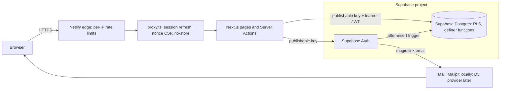

# Threat model (STRIDE, security framework section 5)

Tier C: documented and independently reviewed before Phase 3 (accounts). Phase 2 entries come first, then Phase 3 (accounts and progress), added 29 October 2026 before any Phase 3 code.

A threat closes when its control is implemented **and** verified.

## Entry points (Phase 2)

| Entry point | Who | Data |
|---|---|---|
| Public pages (`/`, `/lessons`, `/lessons/*`, `/certified`) | Anyone | Public content only, read through RLS with the publishable key |
| `/go/[slug]` | Anyone (QR codes) | Writes one scan row (slug, up to three UTM values, time) through `log_qr_scan()` |
| Vimeo iframe | Anyone who presses play | Third-party frame, `player.vimeo.com` only |

## Entry points (Phase 3)

| Entry point | Who | Data |
|---|---|---|
| `/sign-in` (Server Action `requestSignInLink`) | Anyone | Email in; neutral message out |
| `/join`, `/join/[code]` (`lookup_store`, Server Actions `goToStore` and `requestJoinLink`) | Anyone | Store code in; store name out. First name, last name, email and marketing consent in |
| `/auth/confirm` (Server Action `confirmSignIn`) | Anyone holding a link | Token hash in; session cookies out |
| `/dashboard`, change store (`changeStore` → `join_store`), sign out | Signed-in learner | Own profile, own progress, own store name |
| Lesson player (`getResumePoint`, `saveProgress` → `save_lesson_progress`) | Anyone; writes only when signed in | Lesson ID, percent, position |
| Supabase Auth API, called directly (the publishable key is public) | Anyone | The same auth calls the app makes, without the app's honeypot and validation |
| Magic-link email | Anyone with access to the learner's mailbox | One-time token hash in a URL |

## Data flow (Phase 3)

Trust boundaries are the browser to Netlify, Netlify to Supabase, and Supabase to the learner's mailbox. The app doesn't use the secret key in Phase 3. Only the local DB tests and the staging test-user script use it.

## Threats

| ID | Asset / flow | Threat / abuse case | STRIDE | Control | Status |
|---|---|---|---|---|---|
| T-01 | `/go` → `log_qr_scan` | SQL injection through the slug or UTM values | Tampering, EoP | Zod slug validation; UTM allowlist and character set; parameterised plpgsql; `search_path = ''` | Verified (DB tests, 29 Oct 2026) |
| T-02 | `/go` | Scan flooding to inflate counts or grow the table | DoS | Cap of 60 scans per link per minute in the function (mutation-checked); optional Netlify Traffic Rule; 24-month retention (data register) | Cap verified; Netlify rule pending |
| T-03 | `/go` | Open redirect to another site | Spoofing | Redirect is a relative path built only from database slugs, so it can never leave the site the visitor is on. **29 Oct 2026:** the first production version sent absolute URLs on the Netlify deploy address (pinned deploy); fixed and covered by `src/app/go/[slug]/route.test.ts` | Verified (unit tests, curl) |
| T-04 | `qr_links`, `qr_scans` | Reading or editing QR data with the publishable key | Information disclosure, Tampering | RLS on; all privileges revoked from anon and authenticated | Verified (DB tests) |
| T-05 | `/go` | Personal data in URLs reaching our database (for example `?email=`) | Information disclosure | Only five known UTM keys pass, and only three are stored; no IP stored | Verified (unit tests and curl) |
| T-06 | Lesson page | A malicious `vimeo_id` or warranty URL rendered into `src` or `href` | Tampering (XSS) | `isVimeoId` and `safeHttpsUrl` with a host allowlist; CSP `frame-src` allows Vimeo only | Verified (unit tests) |
| T-07 | Vimeo iframe | Third-party tracking of visitors | Information disclosure | Click-to-play; `dnt=1`; tag inventory; APP 8 disclosure | Implemented |
| T-08 | QR counts | Link scanners and bots open QR links ahead of the user, inflating counts | Repudiation (data quality) | Accepted: counts are indicative, not billing data | Accepted (29 Oct 2026) |
| T-09 | `/sign-in`, `/join` | Account enumeration from different messages or timing | Information disclosure | One neutral message for every outcome; `shouldCreateUser: false` on sign-in; a 1.5-second response floor hides most of the email-send delay (review L5); errors logged without the email. Residual: a send slower than the floor still shows; accepted (ASVS 6.3.8 is Level 3) | Verified (local: identical reply, 1791 vs 1793 ms; only the known address got email). Residual timing accepted |
| T-10 | `/sign-in`, `/join`, Auth API | Email bombing a victim, or mass fake sign-ups | DoS, Spoofing | Netlify edge rate limits per IP; honeypot; Supabase per-email resend interval (60 s) and hourly email cap; sign-ups off while EX-01 is open. Direct Auth API calls skip the honeypot: accepted, with Supabase's own limits as the backstop and Turnstile as the next step | Implemented (edge limits proven on preview 15; honeypot tested; sign-ups off). Turnstile not used; residual accepted |
| T-11 | `/join/[code]`, `lookup_store` | Guessing store codes to discover stores or join one | Information disclosure, EoP | 8 random Crockford characters (about 10^12 per prefix), which also covers direct PostgREST calls to `lookup_store` and `join_store` that skip the Netlify edge (review M3); edge rate limit for the pages; lookup returns only name, partner, suburb and state; no list endpoint; learners can't read `store_code` | Verified (DB tests; 8-character codes; no list endpoint; codes unreadable by learners) |
| T-12 | Magic link | Token used by someone else (forwarded email, scanner pre-open, leaked URL or log) | Spoofing | Single use; 10-minute expiry; 10-character code (review M1); the token sits in the URL **fragment**, so it never reaches Netlify or Supabase request logs (review L6), and the page clears it from the address bar; confirm button (POST), so scanners don't spend it; `Referrer-Policy: no-referrer` and `no-store` on `/auth/confirm`; no third-party resources on that page | Verified (local and staging preview: token in the fragment and cleared from the address bar, Continue required, reuse refused, no-referrer) |
| T-13 | `/auth/confirm` `next` value | Open redirect after sign-in | Spoofing | `safeNextPath()` allowlist: only same-site relative paths to known routes | Verified (unit tests) |
| T-14 | Session cookies | Theft by script, fixation, survival after sign-out | Spoofing, EoP | No browser Supabase client, so `HttpOnly`; `__Host-` prefix and `Secure` on HTTPS; `SameSite=Lax`; new session on every sign-in; sign-out revokes the refresh token; 7-day idle and 30-day absolute expiry; `getUser()` checks the session with Supabase Auth on every page; `current_learner()` checks `auth.sessions` in every policy and write function, so a copied access token stops working at sign-out (ASVS 7.4.1) | Verified (local: HttpOnly; DB tests: sign-out ends sessions; preview 15: `__Host-sb-auth`, HttpOnly, Secure, SameSite=Lax, checked by Rich 29 Oct 2026) |
| T-15 | Profiles, progress | One learner reading or changing another's data (IDOR/BOLA) | Information disclosure, Tampering | RLS on `(select public.current_learner())`; direct writes revoked; writes only through definer functions, which take no user ID; a second seeded partner proves cross-partner isolation | Verified (DB tests; two partners; mutation checks) |
| T-16 | Profiles | Learner makes themselves admin, or changes store without a code | EoP | No update grant on `profiles`; the trigger always sets `role = 'learner'`; store changes only through `join_store(code)` | Verified (DB tests; mutation checks) |
| T-17 | Sign-up metadata | Crafted `user_metadata` (huge names, HTML, fake role) through the Auth API | Tampering | `check_new_user` refuses sign-ups without names; `create_profile` reads only known keys, trims and caps lengths, and never reads a role; metadata is never trusted after the profile exists (users can edit it); React escapes names on output | Verified (DB tests) |
| T-18 | Per-request pages and actions | Signed-in HTML or a `Set-Cookie` cached by the CDN and served to someone else | Information disclosure | `Cache-Control: private, no-store` on account pages **and** on Server Action posts to lesson pages (proxy matcher on the `next-action` header, review L7); no user data in `'use cache'`; tested with and without cookies | Verified (production-build header matrix, 29 Oct 2026) |
| T-19 | Server Actions | Forged cross-site POST | Tampering | Next.js Origin check on Server Actions (default kept, no `allowedOrigins`); `SameSite=Lax`; sign-out is POST only | Verified (forged-origin post refused, local production build) |
| T-20 | Lesson progress | Learner fakes watch progress | Tampering | Accepted for Phase 3: progress only unlocks the quiz, which is graded on the server (Phase 4). The function clamps values, keeps the maximum and ignores saves under 2 seconds apart | Accepted (Rich, decision 11, 29 Oct 2026) |
| T-21 | Shared store devices | The next staff member sees, or keeps using, the previous learner's account | Information disclosure | Visible sign-out on every signed-in page, with cookies cleared even if Supabase is unreachable (review L3); "Sign out on all devices"; "Signed in as <email>" on the dashboard; cookie lifetime 30 days, not 400 (review L8); `no-store`, so Back shows nothing cached; 7-day idle timeout; no `'use cache: private'` | Verified (sign-out everywhere, signed-in email shown, no-store; preview 15: Back after sign-out shows no account content, checked by Rich 29 Oct 2026) |
| T-22 | Logs | Emails, tokens or names in logs | Information disclosure | `logSecurityEvent()` accepts only event names, user IDs, error codes and request IDs; magic-link tokens stay in the URL fragment. **Residual:** Netlify and Supabase request logs record paths, so `/join/CODE` store codes appear there (log inventory, SECURITY.md section 10). Accepted: a store code only grants store membership, and those logs are readable only by named team members | Verified (log lines seen locally hold IDs and codes only). Join-path codes in request logs accepted |
| T-23 | Magic-link URL | Link built from the request's Host header, so a poisoned request emails a link to an attacker's site | Spoofing | Links use `siteUrl()` from configuration and the email template's `{{ .SiteURL }}`; Supabase also checks redirects against its allowlist | Verified (unit tests; links use siteUrl() and the template SiteURL) |
| T-24 | Join URLs | Store codes leaking from `/join/CODE` URLs through Referer headers or analytics | Information disclosure | Join pages load no third-party resources; `Referrer-Policy: strict-origin-when-cross-origin` sends no path off-site; GA4 isn't loaded (D6), and if it's added later, join pages are excluded | Implemented (no third-party resources on account pages; header matrix) |
| T-25 | Refresh tokens | A Server Component refreshes a token but can't save the new cookie; reuse detection then signs the learner out | DoS (availability) | `proxy.ts` refreshes before account pages render; Server Components never write cookies; Supabase refresh-token reuse interval of 10 seconds | Implemented (proxy refreshes before account pages render; actions on lesson pages go through the proxy) |
| T-26 | Sign-up | Someone creates an account for another person's address, choosing the names and ticking marketing consent | Spoofing, Repudiation (Spam Act consent) | The profile and the consent timestamp are created only when the mailbox owner confirms with the magic link (`create_profile` on `email_confirmed_at`; review M2). Unconfirmed `auth.users` rows hold the submitted names until the 24-hour purge job, built before sign-ups open (EX-01). Residual: the owner inherits names someone else typed; Phase 5 must let learners check their name before a certificate is issued | Verified (DB test and local join: no profile or consent until confirmed). 24-hour purge job due before sign-ups open |
| T-27 | Auth API password pathway | A session holder (for example, someone with a forwarded link) sets a password and keeps a lasting credential, or changes the email to take over the account | Spoofing, EoP | The `refuse_password_change` trigger blocks setting or changing any password (review H1); `secure_password_change` on. Email changes need both addresses to confirm (`double_confirm_changes`); learners get an email-changed notice; `sync_profile_email` keeps the profile in step. A password chosen at API sign-up still needs the mailbox, a 15-character minimum and the leaked-password check | Verified (DB test: password change refused; staging sign-in unaffected) |
| T-28 | Auth API `/verify` | Guessing the magic-link code for a known address, calling Supabase directly to skip the Netlify limits | Spoofing | `otp_length = 10` (the maximum, about 33 bits); 10-minute expiry; `token_verifications` 10 per 5 minutes per IP at Supabase. Residual: weaker than ASVS asks for stored low-entropy secrets (6.5.2), so it's included in EX-02 | Implemented (code length 10 confirmed on staging; verification limit set). Residual in EX-02 |
| T-29 | Admin recovery | Rich changes a learner's email in the dashboard without checking who is asking, leaves the old sessions running, or keeps no record | Spoofing, Repudiation | The runbook in `PERMISSIONS.md` (review M4): verify the person, change the email with the admin API, sign the user out everywhere, notify both addresses, and log the change against Rich by name, with the date and user ID | Implemented (runbook in PERMISSIONS.md) |

## Supabase security advisor review

Run on staging after the Phase 2 migration, 29 October 2026.

| Finding | Level | Decision |
|---|---|---|
| `rls_enabled_no_policy` on `qr_links`, `qr_scans` | INFO | **Intended.** Deny-all: no role reads or writes these tables directly. |
| `anon_security_definer_function_executable` and `authenticated_security_definer_function_executable` on `log_qr_scan` | WARN | **Intended, by design.** The public `/go` route must record scans, and this function is the narrowest write path: one validated, capped insert with an empty `search_path` (T-01, T-02). The alternatives are worse: granting anon direct insert on `qr_scans` (more surface), or using the secret key on every public `/go` request. Re-review whenever the function changes. |

## Phase 3 review (Task 1 gate)

**Reviewer, 29 October 2026:** a fresh reviewer agent with no build context. It had read-only access to:
- these documents
- the plan
- the framework text
- the ASVS 5.0 chapters
- the Next.js docs

**This is not independent review in the framework's sense** (decision 9). A named human reviewer still has to review it before the Phase 3 gate. **Signed off by Rich, Sales and Marketing Manager, in chat on 29 October 2026**, including EX-02 and the two changed decisions (10-minute links, 8-character store codes).

Every finding was checked against its source before being accepted. For example, `config.toml` really did have `secure_password_change = false` and `otp_length = 6`, and the ASVS 3.4.3 text was read in full. Then every finding was fixed in the plan, registers or design, as below.

| # | Severity | Finding | Disposition |
|---|---|---|---|
| H1 | High | The Auth API lets a session holder set a password, a lasting credential that survives "sign out on all devices". Email change is possible too, and `profiles.email` never synced | **Fixed in design.** Added: • a `refuse_password_change` trigger • `secure_password_change` • a `sync_profile_email` trigger • the email-changed notification • tests for each See T-27 |
| M1 | Medium | The magic-link token hash comes from the 6-digit code, about 20 bits, and the bare code is accepted at `/verify` | **Fixed and documented.** `otp_length = 10`; `token_verifications` 10 per 5 minutes. The residual gap against 6.5.2 is added to EX-02 (T-28) |
| M2 | Medium | Profiles and marketing consent were created before the email was confirmed | **Fixed in design.** The profile is created when the email is confirmed, and a name check runs before insert. Confirmations are on locally too. Unconfirmed sign-ups are purged after 24 hours, a job due before sign-ups open. See T-26 |
| M3 | Medium | `lookup_store` and `join_store` can be called directly through PostgREST, skipping the edge limits | **Fixed.** Store codes now have 8 random characters (about 10^12 per prefix). T-11 corrected |
| M4 | Medium | Admin recovery wasn't logged or notified, and didn't end the user's sessions | **Fixed.** Runbook added to `PERMISSIONS.md`; ASVS 6.4.3 is now Partial (T-29) |
| L1 | Low | ASVS 3.4.3 needs `base-uri 'none'` | **Fixed** in both CSPs and their tests |
| L2 | Low | `current_learner()` ignored the session time-box | **Partly fixed.** A `not_after` check was added, but on staging (29 Oct 2026) magic-link sessions have no `not_after`, so the time-box and the idle timeout are enforced by Supabase Auth at token refresh. An expired session can keep working for up to one access-token lifetime (1 hour). Accepted; documented in ASVS 7.3.1 and 7.3.2 |
| L3 | Low | Sign-out ignored errors and could leave the cookies in place | **Fixed.** Cookies are always cleared; failures are logged |
| L4 | Low | `next` in the email link wasn't URL-encoded | **Fixed** (`urlquery`) |
| L5 | Low | Response timing reveals existing accounts | **Mitigated** with a 1.5-second floor. The residual is accepted (ASVS 6.3.8 is Level 3) |
| L6 | Low | Tokens and store codes in request logs | **Fixed for tokens:** they moved to the URL fragment. **Accepted for store codes**, with the log inventory updated (T-22) |
| L7 | Low | Server Action posts to lesson pages bypassed `proxy.ts` | **Fixed** with a proxy matcher on the `next-action` header |
| L8 | Low | The 400-day cookie `maxAge` | **Fixed:** 30 days |
| L9 | Low | `normalise_store_code` could still be run by anyone | **Fixed:** revoked, and covered by the grant test |
| L10 | Low | ASVS 3.5.4 was marked Met before the subdomain exists | **Fixed:** now Phase 7 |
| Tests | Low | Some † matrix cells had no real test | **Fixed.** Added tests for: • anon updates • a second partner • learner store inserts and partner deletes • updates to another learner's profile • a grant check that tells the two refusal layers apart • error codes on anon reads • global sign-out at the database • a deactivated learner trying to save |
| EX-02 | — | Approve only after H1, M1 and baseline clean-up | **Rewritten** as the reviewer asked: baseline controls removed from the compensating list; Supabase limits and real compensating controls named; 6.5.2 and the NIST deviation added |
