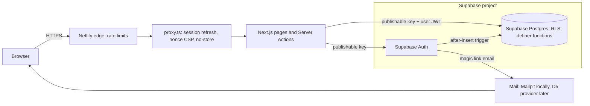

# Phase 3: Accounts and Progress Implementation Plan

> **For agentic workers:** REQUIRED SUB-SKILL: use anthropic-skills:executing-plans (or anthropic-skills:subagent-driven-development) to carry out this plan task by task. Steps use checkbox (`- [ ]`) syntax for tracking.

**Goal:** learners sign in with a magic link, join a store with a code, and their video progress is saved and shown on a dashboard.

**Architecture:**
- **Auth is server-side only.** Supabase Auth (email magic link) runs through `@supabase/ssr` in Server Actions and `proxy.ts`. There are no auth Route Handlers.
  - There is no browser Supabase client, so the session cookies are `HttpOnly` and `__Host-` prefixed (control 09).
  - Every action re-checks the session itself (control 04).
- **The database owns the rules.** Learners can only read their own rows (RLS). Every write goes through a `security definer` function that uses `auth.uid()`; direct inserts and updates are revoked. This is the pattern `log_qr_scan()` already uses.
- **Public lesson pages stay static.** The player asks a Server Action for the resume point when play is pressed, and saves progress through another Server Action. A signed-out visitor costs nothing extra.
- **Signed-in pages (`/dashboard`, `/sign-in`, `/join`, `/auth/confirm`) render per request.** They get a nonce-based CSP (Report-Only first, control 11), `Cache-Control: private, no-store` (control 14), and Netlify edge rate limits (controls 19, 22).

**Tech stack:**
- Next.js 16.4 (Cache Components on), React 19, Tailwind v4
- Supabase Auth and Postgres (RLS and `security definer` functions)
- `@supabase/ssr` 0.12.7 (new dependency, see decision 1)
- Zod, Vitest
- Netlify Edge Functions, only for `rateLimit` config

**Spec:**
- `docs/BUILD_PLAN.md` Phase 3, including its security list
- `docs/PRD.md` sections 5.2, 5.3, 6.3 and 8
- `docs/BRAND.md`: forms, email, progress and certification, voice
- `docs/SECURITY.md` and the framework .docx (Tier C), sections 4 and 5
- `docs/security/THREAT_MODEL.md`
- `CLAUDE.md`
- Next.js bundled docs:
  - `02-guides/authentication-with-cache-components.md`
  - `02-guides/content-security-policy.md`
  - `02-guides/data-security.md`
  - `03-api-reference/03-file-conventions/proxy.md`

Brand references (p.N) point to the local guidelines PDF. Security references (control NN) point to ITWM framework v3.1.

**Framework controls this phase touches:** 02, 03 (no admin UI yet; recorded as not started), 04, 05, 08, 09, 10, 11, 13 (new dependency), 14, 15, 19, 22.

Section 5 also applies:
- the privacy-by-design gate
- the threat model
- the retention register

---

## Decisions and flags (confirm before Task 1)

**Approved by Rich in chat, 29 October 2026: all 16 as recommended.** Decision 9's reviewer isn't named yet, so Task 1 uses the fallback (a fresh reviewer agent, recorded as not independent).

**Changes from the ASVS 5.0 Level 2 review in Task 1** (`docs/security/ASVS.md`), 29 October 2026:
- **Decision 2 tightened:** magic links now expire after **10 minutes**, not 15. ASVS 6.5.5 caps out-of-band links at 10.
- **New exception EX-02 (needs Rich's written approval):** email-only, single-factor sign-in for learners, with links that work in any browser (ASVS 6.3.3, 6.6.2), and no session list (7.5.2). Justification and compensating controls are in `EVIDENCE.md`. The branch-protection exception, if needed, becomes EX-03.
- **Added `current_learner()`** to Task 3. Every policy and write function checks that the session still exists in `auth.sessions` and that the profile is active, so sign-out and deactivation take effect at the database at once (ASVS 7.4.1, 7.4.2). It comes with two new tests and mutation check 5.
- **Added "Sign out on all devices"** (Tasks 9, 12, 14), plus a sign-out button on the signed-in join pages (ASVS 7.4.3, 7.4.4, 7.5.2 in part).
- **`confirmSignIn` ends any existing session before signing in** (ASVS 7.2.4), and logs successful sign-ins (ASVS 16.3.1).
- **The Auth API's password pathway is hardened**, because Supabase can't switch passwords off separately (ASVS 6.1.3, 6.3.4). Settings: 15-character minimum, leaked-password protection, and confirm email kept on (Tasks 4, 17).
- **Log inventory** added to `docs/SECURITY.md` section 10 (ASVS 16.1.1).
- **Collection notice:** both Supabase projects are in Sydney (checked). It also says the website host processes data in the US while decision S9 is open (APP 8).

**Changes from the reviewer agent's findings in Task 1** (full list and dispositions in `THREAT_MODEL.md`, "Phase 3 review"), 29 October 2026:
- **Decision 5 raised: store codes have 8 random characters, not 6.** `lookup_store` and `join_store` can be called straight through the database API, which skips the Netlify limits (M3).
- **No passwords on existing accounts.** A `refuse_password_change` trigger, plus `secure_password_change`. Otherwise anyone holding a session could add a lasting password (H1).
- **Profiles are created when the email is confirmed, not at sign-up.** Nobody can create a profile, or record marketing consent, for someone else's address. Confirmations are now on locally too (M2).
- **Email changes:** confirmed from both addresses, with a notice email and the profile kept in step (H1).
- **Code length and verification limit:** `otp_length = 10`, and `token_verifications` 10 per 5 minutes (M1).
- **Magic-link token moved into the URL fragment**, so it never reaches server logs (L6). `next` is now URL-encoded (L4).
- **`current_learner()` checks the session's end time** (L2).
- **Sign-out always clears the cookies** (L3).
- **Cookie lifetime 30 days**, not 400 (L8).
- **1.5-second response floor** on sign-in and join (L5).
- **`base-uri 'none'`** in both CSPs (L1).
- **The proxy also runs for progress actions on lesson pages** (L7).
- **"Signed in as <email>"** on the dashboard (an EX-02 compensating control).
- **Admin recovery runbook** in `PERMISSIONS.md` (M4).
- **Nine more DB tests.** A second seeded partner, plus a grant check that tells the two refusal layers apart.

1. **New dependency `@supabase/ssr` 0.12.7** (released 8 Sep 2026, so over two weeks old). It's maintained by Supabase, and its only dependency is `cookie`. It handles session cookies and token refresh. Writing that ourselves would be custom auth, which control 02 says to avoid.

2. **Magic links expire after 10 minutes and work once** (control 02). The Supabase default is 60 minutes. Staff who open the email later just request a new link.

3. **Session lifetime** (control 09). Store staff often share devices, so keep sessions shortish:
   - **Recommended:** sign out after **7 days of inactivity**, and always after **30 days**.
   - Access tokens last 1 hour and refresh silently.

   Supabase's "inactivity timeout" and "time-box" settings are Pro features, and both projects are on Pro.

4. **Bot protection: a honeypot field plus Netlify edge rate limits**, and no CAPTCHA. Control 19 names "a honeypot plus rate limiting" as an accepted option.
   - Cloudflare Turnstile would be a new vendor that receives visitor IPs, so it would need a vendor assessment and a privacy notice change.
   - Revisit if spam sign-ups appear. Supabase Auth supports Turnstile natively.

   Proposed limits per IP address. Staff on the same store Wi-Fi share one IP, so these allow a group onboarding session:
   - `/sign-in`: 15 requests a minute
   - `/join`: 30 a minute
   - `/auth/*`: 30 a minute

   Netlify Pro allows 5 code-based rules; this uses 3. A limited visitor sees a 429 for up to a minute.

5. **Store codes get 8 random characters, not 4:** `BCF-ROB-7K2Q9MXH` rather than `BCF-ROB-7K2Q` (PRD 5.2). *(Approved as 6; raised to 8 after the Task 1 review, see below.)*
   - The prefix is guessable, so 4 characters leaves about a million combinations per store. 8 characters gives about 10^12, which stays out of reach even through direct database API calls that skip the Netlify rate limits.
   - The random part uses Crockford base32 (no I, L, O or U), and codes are typed case-insensitively.
   - This changes PRD 5.2's example, so I'll update the PRD.

6. **Account emails during Phase 3** (decision D5 stays open).
   - Supabase's built-in mailer only delivers to project team members, and EX-01 allows fictional `@example.com` users only.
   - So the email itself, its template and its link are tested on the **local stack (Mailpit)**.
   - On staging, fictional users sign in through admin-generated links (no email is sent).
   - Custom SMTP (D5) isn't needed until EX-01 closes and real people are invited.

7. **Privacy policy.** The footer already links to `/privacy`, which is a 404 today, and the join form's collection notice must link to a live policy (Australian Privacy Principle 5, control 19). Options:
   - (a) Carbon Offroad supplies the Academy privacy policy text, and I publish it at `/privacy`.
   - (b) `/privacy` redirects to Carbon Offroad's main website policy, if that policy covers the Academy (training records, store membership, Supabase in the US or Sydney).

   **Recommended: (a)**, with the text reviewed by whoever owns Carbon Offroad's privacy policy. Until then `/privacy` shows a holding page. Blocker for the Phase 3 "done" gate, not for starting.

8. **Retention register: approve section 5 of `docs/SECURITY.md` as drafted**, plus three new rows:

   | Data | Class | Retention (proposed) |
   |---|---|---|
   | Magic-link tokens | Confidential | 10 minutes, single use (Supabase) |
   | Netlify function and edge logs | Internal | Netlify Pro default, not configurable |
   | Profile `last_active_at` | Confidential | As for the profile |

   - The scheduled deletion job ("24 months of inactivity") is built before the Phase 7 gate, not in Phase 3. `last_active_at` is added now so the job has something to measure. That column is beyond the PRD data model, so it needs your OK.
   - Section 5 says Confidential data can't launch with an undefined retention period. Approving it is the gate for Task 3 (the first table holding personal data).

9. **Independent review of the threat model.**
   - BUILD_PLAN says "reviewed by Rich and the independent reviewer". Tier C needs someone other than the builder.
   - Who is it? Options: an ITWM colleague, or a contracted reviewer.
   - Until named, I'll have a fresh reviewer agent with no build context check it as well. That's useful, but not independent in the framework's sense, so the evidence will say so.

10. **CSP stays Report-Only in Phase 3** on the new pages, as control 11 requires ("always start in Report-Only"). It's enforced, together with the public pages' CSP, at the Phase 7 gate, after a clean report period.

11. **What "completed" means in Phase 3:** a lesson is complete once 90% of the video has been watched, the PRD quiz-unlock threshold. Phase 4 changes this to "quiz passed".
    - Watch progress is reported by the browser, so a determined learner can fake it. That's accepted (see the threat model): the server-graded quiz is the real gate for certification.

12. **The header gets a "My Academy" link** to `/dashboard`, which sends signed-out visitors to `/sign-in`. The header stays static, so public pages don't render per request just to show signed-in state.

13. **Customers sign up through `/join` without a code** ("No store code? Join as a customer"). `/sign-in` is for existing accounts only and always shows the same neutral message, so it never reveals whether an email has an account (control 02).

14. **Hosted Supabase settings changes need your OK** (Task 17). Staging gets the changes first, production at merge:
    - Site URL and redirect allowlist
    - Magic-link expiry
    - Session timeouts
    - Email templates
    - Auth rate limits

    **Sign-ups stay off on both projects (EX-01).**

15. **Copy for approval** (brand p.69): sign-in, join, collection notice, confirm page, dashboard and the magic-link email. Drafts are in Tasks 9–14; changes go in before the PR.

16. **Test Vimeo video still needed** (from Phase 2). Without a real video, "progress persists across devices" can be proven only by the DB and action tests, not in the player. One short clip on the Carbon Vimeo account, with `localhost` and the Netlify domains on its embed allowlist, closes this.

**Still open from earlier phases** (they don't block Phase 3, but the framework expects them):
- Branch protection on `main` (control 13, record EX-03 if approvals stay at 0; EX-02 is now the magic-link exception)
- The Dependabot PRs (#2 React 19.3.1, then #4 ESLint 10)
- The `security@` mailbox

---

## How it fits together

```
Join (new learner)
  /join/BCF-ROB-7K2Q9MXH ──GET──► lookup_store(code) ─► "You're joining BCF Robina"
      │ POST (Server Action: Zod, honeypot, edge rate limit)
      ▼
  supabase.auth.signInWithOtp({ shouldCreateUser: true, data: { names, code, consent } })
      │ email (Mailpit locally)           auth.users row (unconfirmed; names checked, no profile)
      ▼
  /auth/confirm?next=/join/CODE#token_hash=…  ── GET shows "Continue" (token stays in the fragment)
      │ POST (Server Action) verifyOtp ─► email confirmed ─► trigger create_profile():
      │                                   profile row, store from code, role 'learner'
      │                                   ─► session cookies (HttpOnly, __Host-, SameSite=Lax)
      ▼
  /join/CODE (signed in, already a member) ─► /dashboard

Sign in (existing learner or customer)
  /sign-in ─POST─► signInWithOtp({ shouldCreateUser: false }) ─► same neutral message either way

Progress
  lesson page (static) ─press play─► getResumePoint(lessonId)  [Server Action]
  player timeupdate / pause / ended ─► saveProgress(lessonId, %, s)  [Server Action, throttled]
      ─► save_lesson_progress() [security definer, auth.uid(), monotonic max %]

Change store
  /join (signed in) ─► enter code ─► /join/CODE "Move to …?" ─POST─► join_store(code)
```

**Why the confirm page has a button instead of signing in on GET:**
- Email security scanners (for example Microsoft Safe Links) open links to inspect them. That would use up a single-use token before the learner clicks.
- A GET that creates a session also allows login CSRF (control 08).
- The cost is one extra tap.

---

## File structure

**Create:**

| Path | Responsibility |
|---|---|
| `supabase/migrations/<ts>_accounts_and_progress.sql` | `partners`, `stores`, `profiles`, `lesson_progress`, grants, RLS, the trigger and four functions |
| `supabase/templates/magic-link.html` | Branded magic-link email (local stack; pasted into hosted projects in Task 17) |
| `tests/db/accounts.test.ts` | Permissions-matrix tests against the local database |
| `tests/db/users.ts` | Test helpers: create a fictional user, sign in as them |
| `src/lib/supabase/server.ts` | `server-only` cookie-based Supabase client (read-only in Server Components, writable in actions) |
| `src/lib/supabase/cookies.ts` | Cookie name and attributes (one place, unit tested) |
| `src/lib/auth/session.ts` | Data access layer: `getCurrentUser()`, `requireUser()`, minimal DTOs |
| `src/lib/auth/actions.ts` | Server Actions: `requestSignInLink`, `requestJoinLink`, `confirmSignIn`, `signOut` |
| `src/lib/auth/next-path.ts` | `safeNextPath()`: post-sign-in redirect allowlist (no open redirect) |
| `src/lib/validation/account.ts` | Zod schemas: email, names, store code, honeypot |
| `src/lib/progress/throttle.ts` | Pure "should we save now?" logic for the player |
| `src/lib/progress/actions.ts` | Server Actions: `getResumePoint`, `saveProgress` |
| `src/lib/stores/lookup.ts` | `server-only` store lookup by code |
| `src/lib/dashboard/data.ts` | `server-only` dashboard DTO |
| `src/config/csp.ts` | Nonce CSP builder for per-request pages |
| `src/proxy.ts` (beside `src/app`, as Next.js requires with a `src/` layout) | Session refresh, nonce CSP and `no-store` on per-request pages |
| `src/lib/site.ts` | `siteUrl()`: the trusted origin for email links (never the request's Host header) |
| `src/lib/log.ts` | `logSecurityEvent()`: structured, PII-free security log lines (control 15) |
| `src/app/(account)/layout.tsx` | Per-request rendering for every account page (route group; URLs unchanged) |
| `src/app/(account)/sign-in/page.tsx`, `SignInForm.tsx` | Sign-in page |
| `src/app/(account)/join/page.tsx`, `src/app/(account)/join/[code]/page.tsx`, `JoinForm.tsx`, `StoreCodeForm.tsx`, `ChangeStoreForm.tsx` | Join and change store |
| `src/app/(account)/auth/confirm/page.tsx`, `ConfirmForm.tsx` | "Continue to the Academy" confirm step |
| `src/app/(account)/dashboard/page.tsx` | Dashboard |
| `src/lib/stores/actions.ts` | Server Actions: `goToStore`, `changeStore` |
| `src/lib/forms/state.ts` | `FormState` returned by every form action |
| `src/lib/dashboard/summary.ts` | Pure split of progress rows into in progress, completed and core count |
| `src/components/account/SignOutButton.tsx` | POST-only sign-out form |
| `tests/config/rate-limits.test.ts` | Pins the edge rate-limit paths and limits |
| `scripts/staging-sign-in-link.mjs` | Local-only: one-time sign-in link for a fictional staging user (no email sent) |
| `src/app/privacy/page.tsx` | Privacy policy (holding page until decision 7 lands) |
| `src/components/forms/Field.tsx`, `Honeypot.tsx`, `FormMessage.tsx` | Brand form primitives (p.49, error-red rules) |
| `src/components/ui/ProgressBar.tsx` | Cyan-on-Gunmetal progress bar (BRAND.md progress) |
| `netlify/edge-functions/rate-limit-sign-in.ts`, `rate-limit-join.ts`, `rate-limit-auth.ts` | Edge rate-limit rules (pass-through functions) |
| `docs/security/PERMISSIONS.md` | Learner permissions matrix (control 04, Appendix A) |
| `docs/security/ASVS.md` | ASVS 5.0.0 Level 2 register (started) |
| Unit tests next to each `src/lib` module (`*.test.ts`) | |

**Modify:**
- `src/components/video/VimeoPlayer.tsx`: resume and progress saves
- `src/lib/content/lessons.ts`: add `id` to the lesson DTO
- `src/app/lessons/[category]/[lesson]/page.tsx`: pass `lessonId`
- `src/components/layout/SiteHeader.tsx`: "My Academy" link
- `supabase/config.toml`: auth settings and template
- `supabase/seed.sql`: fictional partners and stores
- `src/types/database.ts`: regenerated
- `next.config.ts`, `src/config/security-headers.ts` (+ test): public CSP off account paths
- `eslint.config.mjs`: only if ESLint rejects the edge functions (Task 16)
- `docs/security/THREAT_MODEL.md`, `EVIDENCE.md`, `VULNERABILITIES.md` (if needed), `docs/SECURITY.md`, `docs/BUILD_PLAN.md`, `docs/PRD.md` (store code format)

---

## Task 0: Branch

- [ ] **Step 1: Start from an up-to-date main**

```bash
git switch main && git pull --ff-only && git switch -c feat/phase-3-accounts
```

---

## Task 1: Security design before code (section 5, controls 04, 15, 19)

Nothing in Tasks 3–16 starts until Rich has signed off this task, and the reviewer has too (decision 9).

**Files:**
- Modify: `docs/security/THREAT_MODEL.md`
- Modify: `docs/SECURITY.md` (section 5, retention)
- Create: `docs/security/PERMISSIONS.md`
- Create: `docs/security/ASVS.md`

- [ ] **Step 1: Add the Phase 3 entry points and data-flow diagram to `THREAT_MODEL.md`.** Insert after the Phase 2 entry-point table:

````markdown
## Entry points (Phase 3)

| Entry point | Who | Data |
|---|---|---|
| `/sign-in` (Server Action `requestSignInLink`) | Anyone | Email in; neutral message out |
| `/join`, `/join/[code]` (`lookup_store`, Server Action `requestJoinLink`) | Anyone | Store code in; store name out. First name, last name, email, marketing consent in |
| `/auth/confirm` (Server Action `confirmSignIn`) | Anyone holding a link | Token hash in; session cookies out |
| `/dashboard`, change store (`join_store`), sign out | Signed-in learner | Own profile, own progress, own store name |
| Lesson player (`getResumePoint`, `saveProgress` → `save_lesson_progress`) | Anyone; writes only when signed in | Lesson ID, percent, position |
| Supabase Auth API directly (the publishable key is public) | Anyone | Same as the app's auth calls, without our bot checks |

## Data flow (Phase 3)



The app doesn't use the secret key in Phase 3. Only the local DB tests and test-user setup on staging use it.
````

- [ ] **Step 2: Add the Phase 3 threats to the threats table** (below T-08):

```markdown
| T-09 | `/sign-in`, `/join` | Account enumeration from different messages or timing | Information disclosure | One neutral message for every outcome; `shouldCreateUser: false` on sign-in; errors logged without the email | Planned |
| T-10 | `/sign-in`, `/join`, Auth API | Email bombing a victim, or mass fake sign-ups | DoS, Spoofing | Netlify edge rate limits per IP; honeypot; Supabase per-email resend interval and hourly email cap; sign-ups off while EX-01 is open. Direct Auth API calls skip the honeypot: accepted, with Supabase's own limits as the backstop and Turnstile as the next step | Planned |
| T-11 | `/join/[code]`, `lookup_store` | Guessing store codes to discover stores or join one | Information disclosure, EoP | 8 random Crockford characters (about 10^12 per prefix), which also covers direct PostgREST calls to `lookup_store` and `join_store` that skip the Netlify edge (review M3); edge rate limit for the pages; lookup returns only name, partner, suburb and state; no list endpoint; learners can't read `store_code` | Planned |
| T-12 | Magic link | Token used by someone else (forwarded email, scanner pre-open, leaked URL) | Spoofing | Single use; 10-minute expiry; confirm button (POST), so scanners don't spend it; `Referrer-Policy: no-referrer` and `no-store` on `/auth/confirm`; no third-party resources on that page | Planned |
| T-13 | `/auth/confirm` `next` value | Open redirect after sign-in | Spoofing | `safeNextPath()` allowlist: only same-site relative paths to known routes | Planned |
| T-14 | Session cookies | Theft by script, fixation, survival after sign-out | Spoofing, EoP | No browser Supabase client, so `HttpOnly`; `__Host-` prefix and `Secure` on HTTPS; `SameSite=Lax`; new session on every sign-in; sign-out revokes the refresh token; 7-day idle and 30-day absolute expiry | Planned |
| T-15 | Profiles, progress | One learner reading or changing another's data (IDOR/BOLA) | Information disclosure, Tampering | RLS on `(select auth.uid())`; direct writes revoked; writes only through definer functions, which take no user ID | Planned |
| T-16 | Profiles | Learner makes themselves admin, or changes store without a code | EoP | No update grant on `profiles`; the trigger always sets `role = 'learner'`; store changes only through `join_store(code)` | Planned |
| T-17 | Sign-up metadata | Crafted `user_metadata` (huge names, HTML, fake role) through the Auth API | Tampering | The trigger reads only known keys, trims, caps lengths and fails closed on missing names; role is never read from metadata; metadata is never trusted after the profile exists (users can edit it) | Planned |
| T-18 | Per-request pages | Signed-in HTML or a `Set-Cookie` cached by the CDN and served to someone else | Information disclosure | `Cache-Control: private, no-store` on every response that reads or writes the session; no user data in `'use cache'`; tested with and without cookies | Planned |
| T-19 | Server Actions | Forged cross-site POST | Tampering | Next.js Origin check on Server Actions (default kept, no `allowedOrigins`); `SameSite=Lax`; sign-out is POST only | Planned |
| T-20 | Lesson progress | Learner fakes watch progress | Tampering | Accepted for Phase 3: progress only unlocks the quiz, which is graded on the server (Phase 4). The function clamps values and keeps the maximum | Accepted (pending Rich) |
| T-21 | Shared store devices | The next staff member sees the previous learner's dashboard | Information disclosure | Visible sign-out on the dashboard; `no-store` so Back doesn't show cached pages; 7-day idle timeout; no session data in the client router cache (no `'use cache: private'`) | Planned |
| T-22 | Logs | Emails, tokens or names in logs | Information disclosure | Log event names and user IDs only; never log `FormData`, emails or URLs containing `token_hash` | Planned |
```

- [ ] **Step 3: Write `docs/security/PERMISSIONS.md`**

```markdown
# Permissions matrix (security framework control 04, Appendix A)

Roles:
- **anon:** publishable key, no session
- **learner:** signed in, `role = 'learner'`
- **admin:** Phase 6; no admin features exist yet
- **service:** secret key. Used only by DB tests and test-user setup, never by the app in Phase 3

"Fn" means the access happens only through the named `security definer` function, never directly. Every cell marked † has a test in `tests/db/accounts.test.ts`.

| Resource | anon | learner (own rows) | learner (others' rows) | admin | Notes |
|---|---|---|---|---|---|
| `partners` read | ✗ † | Own store's partner † | ✗ † | Phase 6 | |
| `stores` read | ✗ † | Own store: id, name, suburb, state, country; **not** `store_code` † | ✗ † | Phase 6 | |
| Store by code | Fn `lookup_store`: name, partner, suburb, state; active stores only † | Same | n/a | | No list endpoint |
| `stores`, `partners` write | ✗ † | ✗ † | ✗ | Phase 6 | |
| `profiles` read | ✗ † | Own row † | ✗ † | Phase 6 | |
| `profiles` insert | Trigger on `auth.users` only † | ✗ † | ✗ | | Role is always `learner` † |
| `profiles` update | ✗ † | ✗ direct †; store only via Fn `join_store(code)` † | ✗ † | Phase 6 | |
| `lesson_progress` read | ✗ † | Own rows † | ✗ † | Phase 6 reports | |
| `lesson_progress` write | ✗ † | Fn `save_lesson_progress` only: own rows, published lessons, clamped, monotonic † | ✗ (the function takes no user ID) † | | |
| Delete anything | ✗ † | ✗ † | ✗ | Phase 6 | Account deletion on request is manual (Rich) until the Phase 7 retention job |

App-level checks (not RLS), tested in Task 18:
- Every Server Action calls `requireUser()`, or is deliberately public.
- The public ones are `requestSignInLink`, `requestJoinLink` and `confirmSignIn`. `getResumePoint` and `saveProgress` do nothing when signed out.
```

- [ ] **Step 4: Update `docs/SECURITY.md` section 5**
  - Add the three rows from decision 8.
  - Mark the table **Approved by Rich, <date>** once he confirms.
  - Replace the line "All retention periods are proposals…" with the approval record and the commitment to build the deletion job before the Phase 7 gate.

- [ ] **Step 5: Start `docs/security/ASVS.md`**
  1. Read the ASVS 5.0.0 requirements from the OWASP repository: `https://github.com/OWASP/ASVS/tree/master/5.0/en`.
  2. For chapters V2 (Validation and Business Logic), V3 (Web Frontend Security), V6 (Authentication), V7 (Session Management), V8 (Authorization) and V16 (Security Logging and Error Handling), list every Level 1 and Level 2 requirement with these columns:
     - requirement ID
     - one-line summary
     - how the Academy meets it, or N/A with the reason
     - evidence link
     - status
  3. Use IDs exactly as published. Never write requirement IDs from memory.
  4. Each other chapter gets a "to do by Phase 7" line.

- [ ] **Step 6: Review gate**
  1. Send Rich the diff of the four files.
  2. Ask the reviewer from decision 9 to review `THREAT_MODEL.md` and `PERMISSIONS.md`.
  3. Run a fresh reviewer agent on the same files. Give it the framework sections and this plan's architecture, but not this conversation's conclusions.
  4. Record the findings and what was done about each under a new "## Phase 3 review" heading in `THREAT_MODEL.md`.

- [ ] **Step 7: Commit**

```bash
git add docs/security docs/SECURITY.md
git commit -m "docs(security): Phase 3 threat model, data flow, permissions matrix, ASVS register"
```

---

## Task 2: Spike: prove the risky platform pieces first

Three things are unproven on this stack, and later tasks depend on all of them:
1. **Nonce CSP with Cache Components.** The Next.js CSP guide says Partial Prerendering is incompatible with nonces, because static-shell scripts can't carry a per-request nonce.
2. **`@supabase/ssr` session refresh in `proxy.ts`** on the Netlify runtime (checked in Task 7 Step 6, once real auth exists).
3. **Netlify edge `rateLimit`** in front of paths served by Next.js.

The spike uses throwaway files, deleted in Step 7.

- [ ] **Step 1: Install the dependency (decision 1)**

```bash
npm install @supabase/ssr@0.12.7 --save-exact
npm ls @supabase/ssr @supabase/supabase-js
```

Expected: `@supabase/ssr@0.12.7` with no peer warnings. It needs `@supabase/supabase-js ^2.114.0`, and we have ^2.118.0.

- [ ] **Step 2: Spike page.** It renders per request, with no static shell:

```tsx
// src/app/spike/page.tsx (deleted in Step 7)
import { connection } from 'next/server'

export const instant = false

export default async function SpikePage() {
  await connection()
  return <p>Spike rendered at {new Date().toISOString()}</p>
}
```

- [ ] **Step 3: Spike proxy.** With the `src/` layout, Next.js looks for `src/proxy.ts`, beside `src/app`:

```ts
// src/proxy.ts (spike version, replaced in Task 7)
import { type NextRequest, NextResponse } from 'next/server'

export function proxy(request: NextRequest) {
  const nonce = Buffer.from(crypto.randomUUID()).toString('base64')
  const csp = `default-src 'self'; script-src 'self' 'nonce-${nonce}' 'strict-dynamic'; object-src 'none'; base-uri 'none'`
  const headers = new Headers(request.headers)
  headers.set('content-security-policy-report-only', csp)
  const response = NextResponse.next({ request: { headers } })
  response.headers.set('Content-Security-Policy-Report-Only', csp)
  response.headers.set('Cache-Control', 'private, no-store')
  return response
}

export const config = { matcher: ['/spike'] }
```

- [ ] **Step 4: Check against a local production build**

```bash
npm run build && npm start
curl -s -D - http://localhost:3000/spike -o spike.html
grep -o '<script[^>]*>' spike.html | grep -vc 'nonce='
```

Expected:
- The response headers include `Content-Security-Policy-Report-Only` with a nonce.
- The final count is `0`: every `<script>` tag carries the nonce.

If the count isn't 0, set the nonce policy on the **request** as `content-security-policy` instead (Next.js may only read the enforcing header name to find the nonce), keep the **response** header Report-Only, and repeat.

Then open `/spike` in the browser pane. Expected: no "Report Only" CSP violations in the console.

Finally, delete `spike.html`.

- [ ] **Step 5: Spike edge rate limit, on a deploy preview**

```ts
// netlify/edge-functions/rate-limit-spike.ts (deleted in Step 7)
// Local types keep @netlify/edge-functions out of package.json (no new dependency).
type Context = { next: () => Promise<Response> }

export default async (_request: Request, context: Context) => context.next()

export const config = {
  path: '/spike',
  rateLimit: { windowLimit: 5, windowSize: 60, aggregateBy: ['ip', 'domain'] },
}
```

1. Push the branch and open a **draft** PR.
2. In the browser pane, signed in to Netlify (previews need team login), load the preview's `/spike` 8 times within a minute.
3. Expected: requests after the 5th get `429`. Enforcement can lag by up to 10 seconds, so allow one or two extra.

- [ ] **Step 6: Record the outcome** in a "Spike results (Task 2)" section at the end of this plan, then follow the branch that matches:
  - **Nonce works on a fully dynamic route** (expected): per-request pages use `export const instant = false` and `await connection()` in their layout, as in the spike. Carry on.
  - **Nonce doesn't work with Cache Components at all:** stop and tell Rich. Fallbacks:
    - SRI hashes (`experimental.sri`), or
    - a control 11 exception (allowlist CSP plus compensating controls).

    Don't choose alone: an exception needs Rich's written approval (framework section 1).
  - **The edge rate limit doesn't apply in front of Next.js paths:** stop and tell Rich. The fallback is a database-side limiter keyed on a hashed IP with 1-hour retention, which needs a new retention row.

- [ ] **Step 7: Remove the spike files; commit the dependency and the results**

```bash
rm -f src/app/spike/page.tsx src/proxy.ts netlify/edge-functions/rate-limit-spike.ts
rmdir src/app/spike
git add package.json package-lock.json docs/superpowers/plans/2026-10-29-phase-3-accounts-and-progress.md
git commit -m "build: add @supabase/ssr 0.12.7; record Phase 3 platform spike results"
```

---

## Task 3: Database: accounts, stores and progress (controls 04, 06, 15)

**Gate:** Task 1 signed off, and the retention register approved (decision 8).

**Files:**
- Create: `supabase/migrations/<timestamp>_accounts_and_progress.sql` (name it with `npx supabase migration new accounts_and_progress`)
- Create: `tests/db/users.ts`
- Create: `tests/db/accounts.test.ts`

- [ ] **Step 1: Test helpers for fictional users**

```ts
// tests/db/users.ts
import { createClient, type SupabaseClient } from '@supabase/supabase-js'
import { admin } from './clients'

// Fictional @example.com users only (EX-01). Created with the secret key on the local stack.

const url = process.env.SUPABASE_TEST_URL!
const publishable = process.env.SUPABASE_TEST_PUBLISHABLE_KEY!

export type TestUser = { id: string; email: string; client: SupabaseClient }

export async function createTestUser(
  label: string,
  metadata: Record<string, unknown> = { first_name: 'Test', last_name: label },
): Promise<TestUser> {
  const email = `${label}-${crypto.randomUUID().slice(0, 8)}@example.com`
  const { data, error } = await admin.auth.admin.createUser({
    email,
    email_confirm: true,
    user_metadata: metadata,
  })
  if (error) throw error
  return { id: data.user.id, email, client: await signInAs(email) }
}

/** Signs in through a generated magic link, as the app does (verifyOtp with a token hash). */
export async function signInAs(email: string): Promise<SupabaseClient> {
  const { data, error } = await admin.auth.admin.generateLink({ type: 'magiclink', email })
  if (error) throw error
  const client = createClient(url, publishable, { auth: { persistSession: false } })
  const { error: verifyError } = await client.auth.verifyOtp({
    type: 'email',
    token_hash: data.properties.hashed_token,
  })
  if (verifyError) throw verifyError
  return client
}

export async function deleteTestUser(user: TestUser | undefined) {
  if (user) await admin.auth.admin.deleteUser(user.id)
}

/** A client that replays a raw access token, as an attacker with a copied token would. */
export function clientWithToken(accessToken: string): SupabaseClient {
  return createClient(url, publishable, {
    auth: { persistSession: false, autoRefreshToken: false },
    global: { headers: { Authorization: `Bearer ${accessToken}` } },
  })
}
```

- [ ] **Step 2: Write the failing DB tests.** One test per † cell in `PERMISSIONS.md`:

```ts
// tests/db/accounts.test.ts
import { afterAll, beforeAll, describe, expect, it } from 'vitest'
import { admin, publicClient } from './clients'
import { clientWithToken, createTestUser, deleteTestUser, signInAs, type TestUser } from './users'

// Security framework control 04: the Phase 3 permissions matrix (docs/security/PERMISSIONS.md),
// proven against a real database. Fixture codes come from supabase/seed.sql.

const ROBINA = 'TST-ROB-7K2Q9MXH'
const NERANG = 'TST-NER-3H8W4DPA'
const INACTIVE = 'TST-OLD-9X9X9X9X'

let alice: TestUser | undefined
let bob: TestUser | undefined
let lessonId: string

beforeAll(async () => {
  alice = await createTestUser('alice', {
    first_name: '  Alice ',
    last_name: 'Tester',
    store_code: ROBINA.toLowerCase(),
    marketing_opt_in: true,
    role: 'admin',
  })
  bob = await createTestUser('bob', { first_name: 'Bob', last_name: 'Tester' })
  const { data, error } = await admin
    .from('lessons')
    .select('id')
    .eq('published', true)
    .limit(1)
    .single()
  if (error) throw error
  lessonId = data.id
})

afterAll(async () => {
  await deleteTestUser(alice)
  await deleteTestUser(bob)
})

describe('profile trigger', () => {
  it('creates a learner profile with trimmed names, store from code and consent time', async () => {
    const { data } = await admin.from('profiles').select('*').eq('id', alice!.id).single()
    expect(data).toMatchObject({ first_name: 'Alice', last_name: 'Tester', role: 'learner' })
    expect(data!.marketing_opt_in).toBe(true)
    expect(data!.marketing_opt_in_at).not.toBeNull()
    const { data: store } = await admin.from('stores').select('id').eq('store_code', ROBINA).single()
    expect(data!.store_id).toBe(store!.id)
  })

  it('never takes a role from metadata', async () => {
    const { data } = await admin.from('profiles').select('role').eq('id', alice!.id).single()
    expect(data!.role).toBe('learner')
  })

  it('creates a customer (no store) when there is no code', async () => {
    const { data } = await admin.from('profiles').select('store_id, marketing_opt_in').eq('id', bob!.id).single()
    expect(data).toEqual({ store_id: null, marketing_opt_in: false })
  })

  it('ignores an unknown or inactive code instead of failing', async () => {
    const user = await createTestUser('carol', { first_name: 'C', last_name: 'T', store_code: INACTIVE })
    const { data } = await admin.from('profiles').select('store_id').eq('id', user.id).single()
    expect(data!.store_id).toBeNull()
    await deleteTestUser(user)
  })

  it('refuses a sign-up with no names (fails closed)', async () => {
    const { error } = await admin.auth.admin.createUser({
      email: `nameless-${crypto.randomUUID().slice(0, 8)}@example.com`,
      email_confirm: true,
      user_metadata: {},
    })
    expect(error).not.toBeNull()
  })

  it('caps over-long names', async () => {
    const user = await createTestUser('long', { first_name: 'x'.repeat(500), last_name: 'T' })
    const { data } = await admin.from('profiles').select('first_name').eq('id', user.id).single()
    expect(data!.first_name).toHaveLength(50)
    await deleteTestUser(user)
  })

  it('creates no profile (and records no consent) until the email is confirmed (T-26)', async () => {
    const { data: created } = await admin.auth.admin.createUser({
      email: `unconfirmed-${crypto.randomUUID().slice(0, 8)}@example.com`,
      email_confirm: false,
      user_metadata: { first_name: 'Eve', last_name: 'Spoof', marketing_opt_in: true },
    })
    const id = created.user!.id
    expect((await admin.from('profiles').select('id').eq('id', id)).data).toEqual([])
    await admin.auth.admin.updateUserById(id, { email_confirm: true })
    const { data } = await admin.from('profiles').select('marketing_opt_in_at').eq('id', id).single()
    expect(data!.marketing_opt_in_at).not.toBeNull() // stamped at confirmation, not at request
    await admin.auth.admin.deleteUser(id)
  })

  it('refuses to set a password on an existing account (review H1, T-27)', async () => {
    const { error } = await alice!.client.auth.updateUser({ password: 'a-long-test-passphrase-2026' })
    expect(error).not.toBeNull()
    const { error: adminError } = await admin.auth.admin.updateUserById(alice!.id, {
      password: 'a-long-test-passphrase-2026',
    })
    expect(adminError).not.toBeNull()
  })

  it('keeps profiles.email in step with a confirmed email change', async () => {
    const user = await createTestUser('grace')
    const next = `grace-new-${crypto.randomUUID().slice(0, 8)}@example.com`
    await admin.auth.admin.updateUserById(user.id, { email: next, email_confirm: true })
    const { data } = await admin.from('profiles').select('email').eq('id', user.id).single()
    expect(data!.email).toBe(next)
    await deleteTestUser(user)
  })
})

describe('anonymous access', () => {
  // 42501 = permission denied. Asserting the code (not just "no data") means a query that fails
  // for some other reason can't pass as "refused".
  it.each(['partners', 'stores', 'profiles', 'lesson_progress'])('cannot read %s', async (table) => {
    const { error } = await publicClient.from(table).select('*')
    expect(error?.code).toBe('42501')
  })

  it.each([
    ['partners', 'id'],
    ['stores', 'id'],
    ['profiles', 'id'],
    ['lesson_progress', 'user_id'],
  ])('cannot update %s', async (table, key) => {
    const { error } = await publicClient.from(table).update({}).not(key, 'is', null)
    expect(error?.code).toBe('42501')
  })

  // 42501 = permission denied, so the test fails if a write is refused for some other reason
  // (a bad column, say) while the privilege is still there.
  it.each([
    ['partners', 'id'],
    ['stores', 'id'],
    ['profiles', 'id'],
    ['lesson_progress', 'user_id'],
  ])('cannot write or delete %s', async (table, key) => {
    const insert = await publicClient.from(table).insert({})
    expect(insert.error?.code).toBe('42501')
    const del = await publicClient.from(table).delete().not(key, 'is', null)
    expect(del.error?.code).toBe('42501')
  })

  it('looks up an active store by code, case-insensitively, without the code or id', async () => {
    const { data, error } = await publicClient.rpc('lookup_store', { p_code: ' tst-rob-7k2q9mxh ' })
    expect(error).toBeNull()
    expect(data).toEqual([
      { store_name: 'Test Store Robina', partner_name: 'Test Partner', suburb: 'Robina', state: 'QLD' },
    ])
  })

  it('finds nothing for an inactive, unknown or malformed code', async () => {
    for (const p_code of [INACTIVE, 'TST-ROB-00000000', "x' or 1=1 --", 'a'.repeat(500)]) {
      const { data } = await publicClient.rpc('lookup_store', { p_code })
      expect(data).toEqual([])
    }
  })

  it('cannot save progress or join a store', async () => {
    const save = await publicClient.rpc('save_lesson_progress', {
      p_lesson_id: lessonId,
      p_percent: 50,
      p_position_seconds: 10,
    })
    expect(save.error).not.toBeNull()
    const join = await publicClient.rpc('join_store', { p_code: ROBINA })
    expect(join.error).not.toBeNull()
  })

  // Tells the two layers apart: the missing grant fails with "permission denied for function",
  // the in-function check with "not signed in". This proves the grant layer on its own.
  it.each([
    ['join_store', { p_code: ROBINA }],
    ['save_lesson_progress', { p_lesson_id: '00000000-0000-4000-8000-000000000000', p_percent: 1, p_position_seconds: 1 }],
    ['current_learner', {}],
    ['normalise_store_code', { p_code: 'x' }],
  ])('has no EXECUTE grant on %s', async (fn, args) => {
    const { error } = await publicClient.rpc(fn, args)
    expect(error?.code).toBe('42501')
    expect(error?.message).toMatch(/permission denied for function/)
  })
})

describe('learner access', () => {
  it('reads only their own profile', async () => {
    const { data } = await alice!.client.from('profiles').select('id')
    expect(data).toEqual([{ id: alice!.id }])
  })

  it('reads their own store without its code, and no other store', async () => {
    const { data } = await alice!.client.from('stores').select('name')
    expect(data).toEqual([{ name: 'Test Store Robina' }])
    const { error } = await alice!.client.from('stores').select('store_code')
    expect(error).not.toBeNull()
  })

  it('reads their own partner only, never the other partner', async () => {
    // seed.sql has two partners, so this proves cross-partner isolation, not just "one row".
    const { data } = await alice!.client.from('partners').select('name')
    expect(data).toEqual([{ name: 'Test Partner' }])
    const { data: none } = await bob!.client.from('partners').select('name')
    expect(none).toEqual([])
  })

  it('cannot update, insert or delete profiles directly', async () => {
    const update = await alice!.client.from('profiles').update({ role: 'admin' }).eq('id', alice!.id)
    expect(update.error).not.toBeNull()
    const other = await alice!.client.from('profiles').update({ first_name: 'Hacked' }).eq('id', bob!.id)
    expect(other.error).not.toBeNull()
    const insert = await alice!.client
      .from('profiles')
      .insert({ id: bob!.id, first_name: 'x', last_name: 'y', email: 'x@example.com' })
    expect(insert.error).not.toBeNull()
    const del = await alice!.client.from('profiles').delete().eq('id', alice!.id)
    expect(del.error).not.toBeNull()
  })

  it('cannot write stores or partners', async () => {
    const attempts = [
      alice!.client.from('stores').update({ name: 'Hacked' }).neq('name', ''),
      alice!.client.from('stores').delete().neq('name', ''),
      alice!.client.from('stores').insert({ name: 'Fake store', store_code: 'TST-FAK-AAAAAAAA' }),
      alice!.client.from('partners').insert({ name: 'Fake partner' }),
      alice!.client.from('partners').update({ name: 'Hacked' }).neq('name', ''),
      alice!.client.from('partners').delete().neq('name', ''),
    ]
    for (const { error } of await Promise.all(attempts)) expect(error).not.toBeNull()
    const { count } = await admin.from('stores').select('id', { count: 'exact', head: true }).eq('name', 'Hacked')
    expect(count).toBe(0)
  })

  it('saves progress through the function and keeps the maximum percent', async () => {
    await alice!.client.rpc('save_lesson_progress', { p_lesson_id: lessonId, p_percent: 60, p_position_seconds: 30 })
    await new Promise((r) => setTimeout(r, 2100)) // the function ignores saves under 2 s apart
    await alice!.client.rpc('save_lesson_progress', { p_lesson_id: lessonId, p_percent: 20, p_position_seconds: 12 })
    const { data } = await alice!.client
      .from('lesson_progress')
      .select('max_percent, last_position_seconds, completed_at')
      .eq('lesson_id', lessonId)
      .single()
    expect(data).toEqual({ max_percent: 60, last_position_seconds: 12, completed_at: null })
  })

  it('clamps percent and marks the lesson complete at 90%', async () => {
    await new Promise((r) => setTimeout(r, 2100))
    await alice!.client.rpc('save_lesson_progress', { p_lesson_id: lessonId, p_percent: 250, p_position_seconds: -5 })
    const { data } = await alice!.client
      .from('lesson_progress')
      .select('max_percent, last_position_seconds, completed_at')
      .eq('lesson_id', lessonId)
      .single()
    expect(data!.max_percent).toBe(100)
    expect(data!.last_position_seconds).toBe(0)
    expect(data!.completed_at).not.toBeNull()
  })

  it("never sees another learner's progress", async () => {
    const { count } = await admin
      .from('lesson_progress')
      .select('user_id', { count: 'exact', head: true })
      .eq('user_id', alice!.id)
    expect(count).toBeGreaterThan(0) // Alice's rows exist...
    const { data } = await bob!.client.from('lesson_progress').select('user_id').eq('user_id', alice!.id)
    expect(data).toEqual([]) // ...but Bob can't see them
  })

  it('cannot write or delete progress rows directly', async () => {
    const insert = await bob!.client
      .from('lesson_progress')
      .insert({ user_id: bob!.id, lesson_id: lessonId, max_percent: 100 })
    expect(insert.error).not.toBeNull()
    const update = await alice!.client.from('lesson_progress').update({ max_percent: 100 }).eq('user_id', alice!.id)
    expect(update.error).not.toBeNull()
    const del = await alice!.client.from('lesson_progress').delete().eq('user_id', alice!.id)
    expect(del.error).not.toBeNull()
  })

  it('refuses progress on an unpublished lesson', async () => {
    const { data: category } = await admin.from('categories').select('id').limit(1).single()
    const { data: draft } = await admin
      .from('lessons')
      .insert({ category_id: category!.id, slug: 'accounts-test-draft', title: '[TEST] Draft', published: false })
      .select('id')
      .single()
    const { error } = await bob!.client.rpc('save_lesson_progress', {
      p_lesson_id: draft!.id,
      p_percent: 50,
      p_position_seconds: 5,
    })
    expect(error).not.toBeNull()
    await admin.from('lessons').delete().eq('id', draft!.id)
  })

  it('changes store only with a valid code', async () => {
    const { data: moved } = await bob!.client.rpc('join_store', { p_code: NERANG })
    expect(moved).toEqual([{ store_name: 'Test Store Nerang' }])
    const { data: refused } = await bob!.client.rpc('join_store', { p_code: INACTIVE })
    expect(refused).toEqual([])
    const { data } = await admin.from('profiles').select('store_id').eq('id', bob!.id).single()
    const { data: nerang } = await admin.from('stores').select('id').eq('store_code', NERANG).single()
    expect(data!.store_id).toBe(nerang!.id)
  })

  it('deleting the auth user removes the profile and progress (retention cascade)', async () => {
    const user = await createTestUser('dave')
    await user.client.rpc('save_lesson_progress', { p_lesson_id: lessonId, p_percent: 10, p_position_seconds: 1 })
    await deleteTestUser(user)
    const { data: profile } = await admin.from('profiles').select('id').eq('id', user.id)
    const { data: progress } = await admin.from('lesson_progress').select('user_id').eq('user_id', user.id)
    expect(profile).toEqual([])
    expect(progress).toEqual([])
  })
})

describe('session end (ASVS 7.4.1, 7.4.2)', () => {
  it('stops a copied access token working at the database as soon as the learner signs out', async () => {
    const user = await createTestUser('erin')
    const { data } = await user.client.auth.getSession()
    const stale = clientWithToken(data.session!.access_token)
    expect((await stale.from('profiles').select('id')).data).toEqual([{ id: user.id }]) // works now...
    await user.client.auth.signOut({ scope: 'local' })
    expect((await stale.from('profiles').select('id')).data).toEqual([]) // ...not after sign-out
    const save = await stale.rpc('save_lesson_progress', { p_lesson_id: lessonId, p_percent: 5, p_position_seconds: 1 })
    expect(save.error).not.toBeNull()
    await deleteTestUser(user)
  })

  it('cuts off a deactivated learner straight away', async () => {
    const user = await createTestUser('frank')
    await admin.from('profiles').update({ active: false }).eq('id', user.id)
    expect((await user.client.from('profiles').select('id')).data).toEqual([])
    const join = await user.client.rpc('join_store', { p_code: ROBINA })
    expect(join.error).not.toBeNull()
    const save = await user.client.rpc('save_lesson_progress', { p_lesson_id: lessonId, p_percent: 5, p_position_seconds: 1 })
    expect(save.error).not.toBeNull()
    await deleteTestUser(user)
  })

  it('"sign out on all devices" ends the other sessions at the database too', async () => {
    const user = await createTestUser('heidi')
    const phone = await signInAs(user.email) // a second session for the same learner
    const { data } = await phone.auth.getSession()
    const phoneToken = clientWithToken(data.session!.access_token)
    expect((await phoneToken.from('profiles').select('id')).data).toEqual([{ id: user.id }])
    await user.client.auth.signOut({ scope: 'global' })
    expect((await phoneToken.from('profiles').select('id')).data).toEqual([])
    await deleteTestUser(user)
  })
})
```

- [ ] **Step 3: Run the tests to confirm they fail**

```bash
npm run db:start
npm run test:db -- tests/db/accounts.test.ts
```

Expected: FAIL. The `profiles` relation doesn't exist, so `createTestUser` fails in `beforeAll`.

- [ ] **Step 4: Write the migration**

```sql
-- Phase 3: accounts, stores and lesson progress (PRD section 8; docs/security/PERMISSIONS.md).
-- Learners read only their own rows. All writes go through security definer functions that
-- use auth.uid() and never take a user ID (controls 04, 06). search_path is empty in every
-- function, so every name is schema-qualified.

create table public.partners (
  id uuid primary key default gen_random_uuid(),
  name text not null check (length(name) between 1 and 120),
  type text check (length(type) <= 40),
  parent_group text check (length(parent_group) <= 120),
  created_at timestamptz not null default now()
);

create table public.stores (
  id uuid primary key default gen_random_uuid(),
  partner_id uuid not null references public.partners (id) on delete restrict,
  name text not null check (length(name) between 1 and 120),
  suburb text check (length(suburb) <= 80),
  state text check (length(state) <= 40),
  country text not null default 'AU' check (country in ('AU', 'NZ', 'US')),
  -- Prefix, location, then 8 random Crockford base32 characters (decision 5). Stored upper case.
  store_code text not null unique
    check (store_code ~ '^[A-Z]{2,5}-[A-Z]{2,5}-[0-9A-HJKMNP-TV-Z]{8}$'),
  active boolean not null default true,
  created_at timestamptz not null default now()
);

create index stores_partner_id_idx on public.stores (partner_id);

create table public.profiles (
  id uuid primary key references auth.users (id) on delete cascade,
  first_name text not null check (length(first_name) between 1 and 50),
  last_name text not null check (length(last_name) between 1 and 50),
  email text not null check (length(email) <= 254),
  store_id uuid references public.stores (id) on delete set null,
  role text not null default 'learner' check (role in ('learner', 'admin')),
  marketing_opt_in boolean not null default false,
  marketing_opt_in_at timestamptz,
  active boolean not null default true,
  -- For the retention job: delete after 24 months of inactivity (SECURITY.md section 5).
  last_active_at timestamptz not null default now(),
  created_at timestamptz not null default now()
);

create index profiles_store_id_idx on public.profiles (store_id);

create table public.lesson_progress (
  user_id uuid not null references public.profiles (id) on delete cascade,
  lesson_id uuid not null references public.lessons (id) on delete cascade,
  max_percent smallint not null default 0 check (max_percent between 0 and 100),
  last_position_seconds integer not null default 0 check (last_position_seconds >= 0),
  completed_at timestamptz,
  updated_at timestamptz not null default now(),
  primary key (user_id, lesson_id)
);

create index lesson_progress_lesson_id_idx on public.lesson_progress (lesson_id);

alter table public.partners enable row level security;
alter table public.stores enable row level security;
alter table public.profiles enable row level security;
alter table public.lesson_progress enable row level security;

-- Deny by default, then grant back only reads. No direct writes for anyone but the owner role.
revoke all on public.partners, public.stores, public.profiles, public.lesson_progress
  from anon, authenticated;

grant select on public.profiles, public.lesson_progress, public.partners to authenticated;
-- Column grant: learners never see store codes, even their own store's (T-11).
grant select (id, partner_id, name, suburb, state, country) on public.stores to authenticated;

-- The signed-in learner's ID, or null if their session has ended (signed out, expired, revoked)
-- or their profile is deactivated. A JWT stays valid until it expires, so checking auth.sessions
-- makes sign-out and deactivation take effect at the database straight away (ASVS 7.4.1, 7.4.2).
-- Every policy and write function below uses this instead of auth.uid().
create function public.current_learner()
returns uuid
language sql
stable
security definer
set search_path = ''
as $$
  select p.id
  from public.profiles p
  join auth.sessions s on s.user_id = p.id
  where p.id = auth.uid()
    and s.id = nullif(auth.jwt() ->> 'session_id', '')::uuid
    -- Time-boxed sessions carry an end time (review finding L2). The inactivity timeout is
    -- enforced by Supabase Auth at refresh, so it can lag by up to one access-token lifetime.
    and (s.not_after is null or s.not_after > now())
    and p.active
$$;

create policy "Learners read their own profile"
  on public.profiles for select to authenticated
  using (id = (select public.current_learner()));

create policy "Learners read their own progress"
  on public.lesson_progress for select to authenticated
  using (user_id = (select public.current_learner()));

create policy "Learners read their own store"
  on public.stores for select to authenticated
  using (
    id = (select p.store_id from public.profiles p where p.id = (select public.current_learner()))
  );

create policy "Learners read their own store's partner"
  on public.partners for select to authenticated
  using (
    id = (
      select s.partner_id
      from public.stores s
      join public.profiles p on p.store_id = s.id
      where p.id = (select public.current_learner())
    )
  );

-- Normalises a typed store code: trim and upper case. Anything over 40 characters is rejected.
create function public.normalise_store_code(p_code text)
returns text
language sql
immutable
set search_path = ''
as $$
  select case when p_code is null or length(p_code) > 40 then null
              else upper(btrim(p_code)) end
$$;

-- Guards on auth.users. user_metadata comes from the client and is untrusted (T-17).

-- 1. Before insert: refuse a sign-up without names (fail closed at the Auth API).
create function public.check_new_user()
returns trigger
language plpgsql
security definer
set search_path = ''
as $$
begin
  if btrim(coalesce(new.raw_user_meta_data ->> 'first_name', '')) = ''
     or btrim(coalesce(new.raw_user_meta_data ->> 'last_name', '')) = '' then
    raise exception 'first_name and last_name are required';
  end if;
  return new;
end;
$$;

create trigger before_auth_user_created
  before insert on auth.users
  for each row execute function public.check_new_user();

-- 2. No password can be set or changed on an existing account. The app is magic-link only, but
-- Supabase's Auth API (updateUser) would let anyone holding a session, such as someone with a
-- forwarded link, add a lasting password that "sign out on all devices" can't remove
-- (review finding H1, ASVS 6.1.3, T-27). Insert is deliberately not blocked: Supabase may store
-- a random temporary password when it creates a magic-link user. A password chosen at API
-- sign-up still needs the mailbox (confirm email is on) and meets the hosted password rules.
create function public.refuse_password_change()
returns trigger
language plpgsql
security definer
set search_path = ''
as $$
begin
  if coalesce(new.encrypted_password, '') <> ''
     and new.encrypted_password is distinct from old.encrypted_password then
    raise exception 'passwords are not used in the Academy';
  end if;
  return new;
end;
$$;

create trigger refuse_password_change
  before update of encrypted_password on auth.users
  for each row execute function public.refuse_password_change();

-- 3. The profile is created only once the email is confirmed (the first magic-link sign-in),
-- so nobody can create a profile or record marketing consent for someone else's address
-- (review finding M2, T-26). Reads known keys only, trims and caps them, never reads a role.
create function public.create_profile()
returns trigger
language plpgsql
security definer
set search_path = ''
as $$
declare
  v_meta jsonb := coalesce(new.raw_user_meta_data, '{}'::jsonb);
  v_opt_in boolean := coalesce((v_meta ->> 'marketing_opt_in')::boolean, false);
  v_store uuid;
begin
  select s.id into v_store
  from public.stores s
  where s.store_code = public.normalise_store_code(v_meta ->> 'store_code') and s.active;

  insert into public.profiles
    (id, first_name, last_name, email, store_id, marketing_opt_in, marketing_opt_in_at)
  values (
    new.id,
    left(btrim(v_meta ->> 'first_name'), 50),
    left(btrim(v_meta ->> 'last_name'), 50),
    new.email,
    v_store,
    v_opt_in,
    case when v_opt_in then now() end
  )
  on conflict (id) do nothing;
  return new;
end;
$$;

create trigger on_auth_user_confirmed_insert
  after insert on auth.users
  for each row when (new.email_confirmed_at is not null)
  execute function public.create_profile();

create trigger on_auth_user_confirmed_update
  after update of email_confirmed_at on auth.users
  for each row when (old.email_confirmed_at is null and new.email_confirmed_at is not null)
  execute function public.create_profile();

-- 4. Keep profiles.email in step after a confirmed email change (double confirmation is on,
-- and Supabase emails both addresses; review finding H1).
create function public.sync_profile_email()
returns trigger
language plpgsql
security definer
set search_path = ''
as $$
begin
  update public.profiles set email = new.email where id = new.id;
  return new;
end;
$$;

create trigger on_auth_user_email_changed
  after update of email on auth.users
  for each row when (old.email is distinct from new.email)
  execute function public.sync_profile_email();

-- Join page lookup (T-11). Returns only what the page shows. No IDs, no codes, no list.
create function public.lookup_store(p_code text)
returns table (store_name text, partner_name text, suburb text, state text)
language sql
stable
security definer
set search_path = ''
as $$
  select s.name, p.name, s.suburb, s.state
  from public.stores s
  join public.partners p on p.id = s.partner_id
  where s.store_code = public.normalise_store_code(p_code) and s.active
$$;

-- Change store (PRD 6.3). Signed-in learners only; the code is the authorisation.
create function public.join_store(p_code text)
returns table (store_name text)
language plpgsql
security definer
set search_path = ''
as $$
declare
  v_user uuid := public.current_learner();
  v_store uuid;
  v_name text;
begin
  if v_user is null then
    raise exception 'not signed in' using errcode = '42501';
  end if;

  select s.id, s.name into v_store, v_name
  from public.stores s
  where s.store_code = public.normalise_store_code(p_code) and s.active;

  if v_store is null then
    return;
  end if;

  update public.profiles set store_id = v_store, last_active_at = now() where id = v_user;
  return query select v_name;
end;
$$;

-- Progress saves from the player (PRD 5.3). Own rows only, published lessons only. Percent is
-- clamped and only ever goes up; completion is stamped once at 90%. Saves under 2 seconds apart
-- are ignored (the player sends about every 10%, plus pause and end).
create function public.save_lesson_progress(
  p_lesson_id uuid,
  p_percent numeric,
  p_position_seconds integer
)
returns void
language plpgsql
security definer
set search_path = ''
as $$
declare
  v_user uuid := public.current_learner();
  v_percent smallint := least(greatest(coalesce(round(p_percent), 0), 0), 100);
  v_duration integer;
  v_position integer;
begin
  if v_user is null then
    raise exception 'not signed in' using errcode = '42501';
  end if;

  select l.duration_seconds into v_duration
  from public.lessons l
  where l.id = p_lesson_id and l.published;

  if not found then
    raise exception 'lesson not available' using errcode = 'P0002';
  end if;

  v_position := least(greatest(coalesce(p_position_seconds, 0), 0), coalesce(v_duration, 86400));

  insert into public.lesson_progress as lp
    (user_id, lesson_id, max_percent, last_position_seconds, completed_at, updated_at)
  values
    (v_user, p_lesson_id, v_percent, v_position, case when v_percent >= 90 then now() end, now())
  on conflict (user_id, lesson_id) do update
    set max_percent = greatest(lp.max_percent, excluded.max_percent),
        last_position_seconds = excluded.last_position_seconds,
        completed_at = coalesce(lp.completed_at, excluded.completed_at),
        updated_at = now()
    where lp.updated_at < now() - interval '2 seconds';

  update public.profiles set last_active_at = now()
  where id = v_user and last_active_at < now() - interval '1 hour';
end;
$$;

-- Postgres grants EXECUTE to PUBLIC by default, and Supabase's default privileges also grant it
-- to anon and authenticated, so revoke from all three before granting back.
revoke all on function public.check_new_user() from public, anon, authenticated;
revoke all on function public.refuse_password_change() from public, anon, authenticated;
revoke all on function public.create_profile() from public, anon, authenticated;
revoke all on function public.sync_profile_email() from public, anon, authenticated;
-- Only used inside the definer functions above; not an API (review finding L9).
revoke all on function public.normalise_store_code(text) from public, anon, authenticated;
revoke all on function public.current_learner() from public, anon, authenticated;
grant execute on function public.current_learner() to authenticated;
revoke all on function public.lookup_store(text) from public, anon, authenticated;
revoke all on function public.join_store(text) from public, anon, authenticated;
revoke all on function public.save_lesson_progress(uuid, numeric, integer)
  from public, anon, authenticated;
grant execute on function public.lookup_store(text) to anon, authenticated;
grant execute on function public.join_store(text) to authenticated;
grant execute on function public.save_lesson_progress(uuid, numeric, integer) to authenticated;
```

Anon calls to `join_store` and `save_lesson_progress` are refused twice: first by the missing grant, then by the `current_learner()` check. Two layers on purpose.

`current_learner()` reads `auth.sessions`. If the hosted projects' JWTs don't carry a `session_id` claim, every learner would get nothing. The sign-out test below catches that locally, and Task 17 re-runs the check on staging. The anon test passes with either one alone, so it doesn't count as mutation evidence for the grant.

- [ ] **Step 5: Seed fictional partners and stores.** Append to `supabase/seed.sql`:

```sql
-- Phase 3 fixtures: fictional partner and stores (TST prefix). Never real stores (EX-01).
insert into public.partners (id, name, type) values
  ('00000000-0000-4000-8000-000000000101', 'Test Partner', 'retail_group'),
  -- A second partner, so tests prove cross-partner isolation (review finding).
  ('00000000-0000-4000-8000-000000000102', 'Other Partner', 'independent');

insert into public.stores (partner_id, name, suburb, state, store_code, active) values
  ('00000000-0000-4000-8000-000000000101', 'Test Store Robina', 'Robina', 'QLD', 'TST-ROB-7K2Q9MXH', true),
  ('00000000-0000-4000-8000-000000000101', 'Test Store Nerang', 'Nerang', 'QLD', 'TST-NER-3H8W4DPA', true),
  ('00000000-0000-4000-8000-000000000101', 'Test Store Closed', 'Southport', 'QLD', 'TST-OLD-9X9X9X9X', false),
  ('00000000-0000-4000-8000-000000000102', 'Other Store Burleigh', 'Burleigh Heads', 'QLD', 'TST-BUR-5T6Y7Z8W', true);
```

- [ ] **Step 6: Apply, run the tests, regenerate types**

```bash
npm run db:reset
npm run test:db
npm run db:types
```

Expected: every test in `accounts.test.ts`, `rls.test.ts` and `qr.test.ts` passes.

- [ ] **Step 7: Mutation checks** (control 04 evidence; the same approach as Phases 1 and 2). Each change must turn at least one test red. Revert by hand after each one; don't use `git checkout` on an uncommitted file.
  1. Change the profiles policy to `using (true)`. Expected: "reads only their own profile" fails.
  2. In `save_lesson_progress`, drop `and l.published`. Expected: "refuses progress on an unpublished lesson" fails.
  3. Replace `greatest(lp.max_percent, excluded.max_percent)` with `excluded.max_percent`. Expected: "keeps the maximum percent" fails.
  4. Change the stores column grant to `grant select on public.stores`. Expected: "without its code" fails.
  5. In `current_learner()`, drop the `join auth.sessions` line and its `s.id = …` condition. Expected: "stops a copied access token working…" fails.

  After each, run `npm run db:reset && npm run test:db`.

- [ ] **Step 8: Run the security advisor locally**, if the CLI supports it (`npx supabase db lint`). Expected: no errors.
  - Each `security definer` WARN is reviewed as intended and documented, as in Phase 2.

- [ ] **Step 9: Commit**

```bash
git add supabase/migrations supabase/seed.sql tests/db src/types/database.ts
git commit -m "feat(db): partners, stores, profiles and lesson progress with RLS and definer functions"
```

---
## Task 4: Local auth settings and the magic-link email (controls 02, 09, 19; brand p.16, p.45)

**Files:**
- Modify: `supabase/config.toml`
- Create: `supabase/templates/magic-link.html`

- [ ] **Step 1: Set the local auth settings.** Hosted projects mirror these in Task 17. In `supabase/config.toml`:

```toml
[auth]
site_url = "http://localhost:3000"
additional_redirect_urls = ["http://localhost:3000/**"]
# Local only. Hosted projects keep sign-ups OFF while EX-01 is open.
enable_signup = true
# The app never uses passwords, but Supabase's email provider still accepts them through
# the Auth API. Make that pathway as strong as ASVS asks (6.1.3, 6.2.1, 6.3.4).
minimum_password_length = 15

[auth.rate_limit]
# Emails per hour, local stack only (Mailpit). Hosted value is set in Task 17.
email_sent = 30
# Link and code checks per 5 minutes per IP. These calls can go straight to Supabase and
# skip the Netlify edge limits, so keep this low (review finding M1, T-28).
token_verifications = 10

[auth.email]
enable_signup = true
# On, as on the hosted projects: the profile is created only when the email is confirmed (T-26).
enable_confirmations = true
# Email changes need confirming from both addresses (ASVS 7.5.1).
double_confirm_changes = true
# Belt and braces with the refuse_password_change trigger (review finding H1).
secure_password_change = true
# A new link can be requested once a minute per address (T-10).
max_frequency = "60s"
# Magic links expire after 10 minutes (decision 2, ASVS 6.5.5).
otp_expiry = 600
# The magic-link token is derived from this code, so its length sets the guessing difficulty.
# 10 is the maximum Supabase allows (review finding M1, ASVS 6.5.4, 6.6.3).
otp_length = 10

# Tell the learner when their email address changes (control 02).
[auth.email.notification.email_changed]
enabled = true

[auth.email.template.magic_link]
subject = "Your Carbon Offroad Academy sign-in link"
content_path = "./supabase/templates/magic-link.html"

# New users get the "confirmation" email when confirmations are on (hosted default).
# Same design and link, so both paths look and work the same.
[auth.email.template.confirmation]
subject = "Your Carbon Offroad Academy sign-in link"
content_path = "./supabase/templates/magic-link.html"

# Decision 3: sign out after 7 days of inactivity, and always after 30 days.
[auth.sessions]
timebox = "720h"
inactivity_timeout = "168h"
```

Edit the existing keys in place; don't add duplicate sections. The subject is 40 characters, under the 45 in BRAND.md Email.

If the CLI rejects `otp_length = 10` or the `email_changed` notification section, record the maximum it accepts and tell Rich. Don't silently drop the setting. EX-02's compensating controls depend on it.

- [ ] **Step 2: Write the email template.** Arial only (p.28: never mix families in one email), 600 px single column, centred white-on-black header (p.45, approved), one CTA:

```html
<!doctype html>
<html lang="en-AU">
  <head>
    <meta charset="utf-8" />
    <meta name="viewport" content="width=device-width, initial-scale=1" />
    <meta name="color-scheme" content="light dark" />
    <title>Sign in to the Carbon Offroad Academy</title>
  </head>
  <body style="margin:0;padding:0;background:#E6E6E6;">
    <!-- Preview text (BRAND.md Email: always written) -->
    <div style="display:none;max-height:0;overflow:hidden;">
      Your sign-in link. It works once and expires in 10 minutes.
    </div>
    <table role="presentation" width="100%" cellpadding="0" cellspacing="0" style="background:#E6E6E6;">
      <tr>
        <td align="center" style="padding:24px 12px;">
          <table role="presentation" width="600" cellpadding="0" cellspacing="0" style="width:100%;max-width:600px;background:#FFFFFF;">
            <tr>
              <td align="center" style="background:#111111;padding:24px;">
                <a href="{{ .SiteURL }}">
                  
                </a>
              </td>
            </tr>
            <tr>
              <td style="padding:32px 32px 8px;font-family:Arial,Helvetica,sans-serif;color:#111111;">
                <h1 style="margin:0 0 16px;font-size:26px;line-height:1.2;font-weight:bold;">Sign in to the Academy</h1>
                <p style="margin:0 0 24px;font-size:16px;line-height:1.5;">
                  Tap the button to sign in to the Carbon Offroad Academy. The link works once and expires in 10 minutes.
                </p>
                <table role="presentation" cellpadding="0" cellspacing="0">
                  <tr>
                    <td style="background:#00A4C7;">
                      <a href="{{ .SiteURL }}/auth/confirm?next={{ .RedirectTo | urlquery }}#token_hash={{ .TokenHash }}"
                         style="display:inline-block;padding:14px 28px;min-height:16px;font-family:Arial,Helvetica,sans-serif;font-size:16px;font-weight:bold;text-transform:uppercase;color:#111111;text-decoration:none;">
                        Sign in
                      </a>
                    </td>
                  </tr>
                </table>
                <p style="margin:24px 0 0;font-size:16px;line-height:1.5;">
                  Didn't ask for this? Ignore this email. Nobody can sign in without the link.
                </p>
              </td>
            </tr>
            <tr>
              <td style="padding:24px 32px 32px;"></td>
            </tr>
            <tr>
              <td style="background:#303030;padding:24px 32px;font-family:Arial,Helvetica,sans-serif;font-size:14px;line-height:1.5;color:#FFFFFF;">
                Carbon Offroad (KPD Industries Pty Ltd)<br />
                Unit 1a, 1 Waterway Drive, Coomera QLD 4209<br />
                [PHONE TBC]
              </td>
            </tr>
          </table>
        </td>
      </tr>
    </table>
  </body>
</html>
```

Flags for the summary:
- **`[PHONE TBC]`**.
- **The address is hard-coded.** BRAND.md says it comes from `settings`, but Supabase templates can't read our database. Update it here and in both hosted projects when the move to Ormeau happens (February 2027). This deviation needs Rich's OK.
- **The logo loads from `{{ .SiteURL }}`.** Locally that's `localhost`, so most mail clients won't show it (the alt text shows instead). That's expected in Mailpit.

How the link is built:
- **The token hash goes after `#`**, so it never reaches a server log (review finding L6).
- **`next` is URL-encoded** with Go's `urlquery` (control 19: encode template variables for their context, review finding L4). `safeNextPath()` then reduces it to an allowlisted path.
- **Check in Mailpit** that the link reads `…/auth/confirm?next=http%3A%2F%2Flocalhost%3A3000%2Fjoin%2F…#token_hash=…`. If Supabase's template engine rejects `urlquery`, stop and tell Rich rather than removing the encoding.

- [ ] **Step 3: Restart the stack and check the template is picked up**

```bash
npx supabase stop && npm run db:start
```

Expected: starts without config errors. The email itself is checked in Task 11, Step 5.

- [ ] **Step 4: Commit**

```bash
git add supabase/config.toml supabase/templates/magic-link.html
git commit -m "feat(auth): local auth settings and branded magic-link email"
```

---

## Task 5: Server-side Supabase session client and data access layer (controls 04, 09, 10)

**Files:**
- Create: `src/lib/site.ts`, `src/lib/site.test.ts`
- Create: `src/lib/supabase/cookies.ts`, `src/lib/supabase/cookies.test.ts`
- Create: `src/lib/supabase/server.ts`
- Create: `src/lib/auth/session.ts`
- Create: `src/lib/log.ts`, `src/lib/log.test.ts`

- [ ] **Step 1: Write the failing tests**

```ts
// src/lib/site.test.ts
import { afterEach, describe, expect, it, vi } from 'vitest'
import { siteUrl } from './site'

afterEach(() => vi.unstubAllEnvs())

describe('siteUrl', () => {
  it('returns the configured origin without a trailing slash', () => {
    vi.stubEnv('NEXT_PUBLIC_SITE_URL', 'https://academy.carbonoffroad.com.au/')
    expect(siteUrl()).toBe('https://academy.carbonoffroad.com.au')
  })

  it('refuses a value with a path, so links are never built from a bad setting', () => {
    vi.stubEnv('NEXT_PUBLIC_SITE_URL', 'https://example.com/evil')
    expect(() => siteUrl()).toThrow()
  })
})
```

```ts
// src/lib/supabase/cookies.test.ts
import { describe, expect, it } from 'vitest'
import { authCookieOptions, isAuthCookie } from './cookies'

// Security framework control 09: Secure, HttpOnly, SameSite and the __Host- prefix.
describe('authCookieOptions', () => {
  it('uses a __Host- prefixed, HttpOnly, Secure, Lax cookie on HTTPS', () => {
    expect(authCookieOptions('https://academy.carbonoffroad.com.au')).toEqual({
      name: '__Host-sb-auth',
      httpOnly: true,
      secure: true,
      sameSite: 'lax',
      path: '/',
      maxAge: 60 * 60 * 24 * 30,
    })
  })

  it('recognises every session cookie name, and nothing else', () => {
    for (const name of ['__Host-sb-auth', '__Host-sb-auth.0', '__Host-sb-auth.1', '__Host-sb-auth-code-verifier']) {
      expect(isAuthCookie(name, '__Host-sb-auth')).toBe(true)
    }
    expect(isAuthCookie('__Host-sb-authx', '__Host-sb-auth')).toBe(false)
    expect(isAuthCookie('analytics', '__Host-sb-auth')).toBe(false)
  })

  it('drops Secure and the prefix only for local http development', () => {
    expect(authCookieOptions('http://localhost:3000')).toMatchObject({
      name: 'sb-auth',
      httpOnly: true,
      secure: false,
    })
  })
})
```

```ts
// src/lib/log.test.ts
import { describe, expect, it, vi } from 'vitest'
import { logSecurityEvent } from './log'

describe('logSecurityEvent', () => {
  it('writes one JSON line with the event and allowed fields only', () => {
    const spy = vi.spyOn(console, 'info').mockImplementation(() => {})
    logSecurityEvent('sign_in_failed', { userId: 'u1', code: 'otp_expired' })
    const line = JSON.parse(spy.mock.calls[0]![0] as string)
    expect(line).toMatchObject({ kind: 'security', event: 'sign_in_failed', userId: 'u1', code: 'otp_expired' })
    expect(typeof line.at).toBe('string')
    spy.mockRestore()
  })
})
```

- [ ] **Step 2: Run them to confirm they fail**

```bash
npx vitest run src/lib/site.test.ts src/lib/supabase/cookies.test.ts src/lib/log.test.ts
```

Expected: FAIL, because the modules don't exist yet.

- [ ] **Step 3: Implement**

```ts
// src/lib/site.ts
import { required } from '@/lib/env'

/**
 * The site's own origin, from configuration. Email links and redirects are built from this,
 * never from the request's Host header, which an attacker controls (control 12).
 */
export function siteUrl(): string {
  const url = new URL(required(process.env.NEXT_PUBLIC_SITE_URL, 'NEXT_PUBLIC_SITE_URL'))
  if (url.pathname !== '/' || url.search || url.hash) {
    throw new Error('NEXT_PUBLIC_SITE_URL must be an origin only, like https://example.com')
  }
  return url.origin
}
```

```ts
// src/lib/supabase/cookies.ts
/**
 * Session cookie attributes (security framework control 09). There is no browser Supabase
 * client, so the cookie can be HttpOnly. __Host- needs Secure, so plain-http local
 * development uses an unprefixed name.
 */
export function authCookieOptions(site: string) {
  const secure = site.startsWith('https://')
  return {
    name: secure ? '__Host-sb-auth' : 'sb-auth',
    httpOnly: true,
    secure,
    sameSite: 'lax' as const,
    path: '/',
    // Matches the 30-day absolute session limit (decision 3). @supabase/ssr defaults to 400 days
    // (review finding L8).
    maxAge: 60 * 60 * 24 * 30,
  }
}

/** Every cookie name @supabase/ssr may use for the session: base, chunks (.0, .1…), PKCE verifier. */
export function isAuthCookie(cookieName: string, baseName: string): boolean {
  return cookieName === baseName || cookieName.startsWith(`${baseName}.`) || cookieName.startsWith(`${baseName}-`)
}
```

```ts
// src/lib/log.ts
type SecurityEvent =
  | 'sign_in_link_failed'
  | 'join_link_failed'
  | 'sign_in_failed'
  | 'sign_in_succeeded'
  | 'sign_out_failed'
  | 'honeypot_tripped'
  | 'store_code_not_found'
  | 'progress_save_failed'
  | 'store_change_failed'

/** IDs and error codes only. Never emails, names, form data, tokens or URLs (control 15, T-22). */
type Fields = { userId?: string; code?: string; requestId?: string }

export function logSecurityEvent(event: SecurityEvent, fields: Fields = {}) {
  console.info(JSON.stringify({ kind: 'security', event, ...fields, at: new Date().toISOString() }))
}
```

```ts
// src/lib/supabase/server.ts
import 'server-only'
import { createServerClient } from '@supabase/ssr'
import { cookies } from 'next/headers'
import { required } from '@/lib/env'
import { siteUrl } from '@/lib/site'
import type { Database } from '@/types/database'
import { authCookieOptions } from './cookies'

/**
 * Supabase client acting as the signed-in user, from the session cookies. RLS applies.
 * Server Components can't set cookies, so writes are ignored there. proxy.ts has already
 * refreshed the session for per-request pages, and Server Actions can write.
 */
export async function createSessionClient() {
  const cookieStore = await cookies()
  return createServerClient<Database>(
    required(process.env.NEXT_PUBLIC_SUPABASE_URL, 'NEXT_PUBLIC_SUPABASE_URL'),
    required(
      process.env.NEXT_PUBLIC_SUPABASE_PUBLISHABLE_KEY,
      'NEXT_PUBLIC_SUPABASE_PUBLISHABLE_KEY',
    ),
    {
      cookieOptions: authCookieOptions(siteUrl()),
      cookies: {
        getAll: () => cookieStore.getAll(),
        setAll(cookiesToSet) {
          try {
            for (const { name, value, options } of cookiesToSet) {
              cookieStore.set(name, value, options)
            }
          } catch {
            // Called from a Server Component: proxy.ts refreshes the session instead.
          }
        },
      },
    },
  )
}
```

```ts
// src/lib/auth/session.ts
import 'server-only'
import { redirect } from 'next/navigation'
import { cache } from 'react'
import { createSessionClient } from '@/lib/supabase/server'

/** The minimal signed-in user DTO. Pages and actions get this, never the raw session. */
export type CurrentUser = { id: string; firstName: string; email: string; storeName: string | null }

/**
 * Data access layer (security framework section 4). getUser() asks Supabase Auth, so a
 * revoked session is refused straight away (control 09). Deactivated learners count as
 * signed out. Per-request memoised with React cache; never 'use cache' (control 14).
 */
export const getCurrentUser = cache(async (): Promise<CurrentUser | null> => {
  const supabase = await createSessionClient()
  const { data, error } = await supabase.auth.getUser()
  if (error || !data.user) return null
  const { data: profile } = await supabase
    .from('profiles')
    .select('first_name, active, stores(name)')
    .eq('id', data.user.id)
    .maybeSingle()
  if (!profile?.active) return null
  return {
    id: data.user.id,
    firstName: profile.first_name,
    email: data.user.email ?? '',
    storeName: profile.stores?.name ?? null,
  }
})

export async function requireUser(): Promise<CurrentUser> {
  const user = await getCurrentUser()
  if (!user) redirect('/sign-in')
  return user
}
```

- [ ] **Step 4: Run the tests and typecheck**

```bash
npx vitest run src/lib/site.test.ts src/lib/supabase/cookies.test.ts src/lib/log.test.ts
npm run typecheck
```

Expected: PASS. Typecheck passes once Task 3 has regenerated the types (`profiles`, `stores`).

- [ ] **Step 5: Commit**

```bash
git add src/lib/site.ts src/lib/site.test.ts src/lib/supabase src/lib/auth/session.ts src/lib/log.ts src/lib/log.test.ts
git commit -m "feat(auth): server-only session client, cookie policy and data access layer"
```

---

## Task 6: Input schemas and the post-sign-in redirect allowlist (controls 05, 12)

**Files:**
- Create: `src/lib/validation/account.ts`, `src/lib/validation/account.test.ts`
- Create: `src/lib/auth/next-path.ts`, `src/lib/auth/next-path.test.ts`

- [ ] **Step 1: Write the failing tests**

```ts
// src/lib/validation/account.test.ts
import { describe, expect, it } from 'vitest'
import { Email, JoinInput, PersonName, SignInInput, StoreCode } from './account'

describe('Email', () => {
  it('trims and lower-cases', () => {
    expect(Email.parse('  Pat@Example.COM ')).toBe('pat@example.com')
  })
  it.each(['', 'not-an-email', 'a@b', `${'a'.repeat(250)}@example.com`, 'pat@example.com\r\nBcc: x@y.z'])(
    'rejects %j',
    (value) => {
      expect(Email.safeParse(value).success).toBe(false)
    },
  )
})

describe('PersonName', () => {
  it.each(["O'Brien", 'Anne-Marie', 'José', 'Ngô Thị', 'St. John'])('accepts %s', (value) => {
    expect(PersonName.parse(` ${value} `)).toBe(value)
  })
  it.each(['', ' ', '<script>', 'x'.repeat(51), 'Robert"); DROP', 'a\u0000b'])('rejects %j', (value) => {
    expect(PersonName.safeParse(value).success).toBe(false)
  })
})

describe('StoreCode', () => {
  it('normalises case and whitespace', () => {
    expect(StoreCode.parse(' tst-rob-7k2q9mxh ')).toBe('TST-ROB-7K2Q9MXH')
  })
  it.each(['TST-ROB-7K2Q', 'TST-ROB-7K2Q9MXI', 'TSTROB7K2Q9M', "x' or 1=1", 'A'.repeat(41)])('rejects %j', (value) => {
    expect(StoreCode.safeParse(value).success).toBe(false)
  })
})

describe('form inputs', () => {
  it('reads the sign-in form, with an empty honeypot', () => {
    expect(SignInInput.parse({ email: 'pat@example.com', website: '' })).toEqual({
      email: 'pat@example.com',
      website: '',
    })
  })

  it('reads the join form and turns the checkbox into a boolean', () => {
    const parsed = JoinInput.parse({
      firstName: 'Pat',
      lastName: 'Lee',
      email: 'pat@example.com',
      marketingOptIn: 'on',
      code: 'tst-rob-7k2q9mxh',
      website: '',
    })
    expect(parsed).toEqual({
      firstName: 'Pat',
      lastName: 'Lee',
      email: 'pat@example.com',
      marketingOptIn: true,
      code: 'TST-ROB-7K2Q9MXH',
      website: '',
    })
  })

  it('treats a missing checkbox as no consent, and a missing code as a customer', () => {
    const parsed = JoinInput.parse({ firstName: 'Pat', lastName: 'Lee', email: 'pat@example.com', website: '' })
    expect(parsed.marketingOptIn).toBe(false)
    expect(parsed.code).toBeUndefined()
  })

  it('drops unknown fields, so a role or store id can never be passed through (mass assignment)', () => {
    const parsed = JoinInput.parse({
      firstName: 'Pat',
      lastName: 'Lee',
      email: 'pat@example.com',
      website: '',
      role: 'admin',
      store_id: 'x',
    })
    expect(parsed).not.toHaveProperty('role')
    expect(parsed).not.toHaveProperty('store_id')
  })
})
```

```ts
// src/lib/auth/next-path.test.ts
import { describe, expect, it } from 'vitest'
import { safeNextPath } from './next-path'

const SITE = 'https://academy.carbonoffroad.com.au'

// T-13: the post-sign-in redirect never leaves the site and only goes to known pages.
describe('safeNextPath', () => {
  it.each([
    ['/dashboard', '/dashboard'],
    ['/join/TST-ROB-7K2Q9MXH', '/join/TST-ROB-7K2Q9MXH'],
    ['/lessons/winches/scout-pro-10k-v3', '/lessons/winches/scout-pro-10k-v3'],
    [`${SITE}/join/TST-ROB-7K2Q9MXH`, '/join/TST-ROB-7K2Q9MXH'],
    ['/dashboard?utm_source=x#top', '/dashboard'],
  ])('allows %s', (input, expected) => {
    expect(safeNextPath(input, SITE)).toBe(expected)
  })

  it.each([
    null,
    '',
    '//evil.example/dashboard',
    '/\\evil.example',
    'https://evil.example/dashboard',
    'javascript:alert(1)',
    'https://academy.carbonoffroad.com.au.evil.example/dashboard',
    '/auth/confirm',
    '/sign-in',
    '/join/../../etc',
    '/admin',
  ])('falls back to /dashboard for %j', (input) => {
    expect(safeNextPath(input, SITE)).toBe('/dashboard')
  })
})
```

- [ ] **Step 2: Run them to confirm they fail**

```bash
npx vitest run src/lib/validation/account.test.ts src/lib/auth/next-path.test.ts
```

Expected: FAIL, because the modules aren't found.

- [ ] **Step 3: Implement**

```ts
// src/lib/validation/account.ts
import { z } from 'zod'

// Security framework control 05: every Server Action parses its input with these schemas.
// z.object strips unknown keys, so extra fields (role, store_id) never get through.

export const Email = z.string().trim().toLowerCase().max(254).pipe(z.email())

/** Letters (any language), combining marks, spaces, apostrophes, hyphens and full stops. */
export const PersonName = z
  .string()
  .trim()
  .min(1)
  .max(50)
  .regex(/^[\p{L}\p{M}' .-]+$/u)

/** PREFIX-LOCATION-XXXXXX, the last part in Crockford base32 (decision 5). */
export const StoreCode = z
  .string()
  .max(40)
  .trim()
  .toUpperCase()
  .regex(/^[A-Z]{2,5}-[A-Z]{2,5}-[0-9A-HJKMNP-TV-Z]{8}$/)

/** Hidden field that people never fill in, but bots do (control 19). */
const Honeypot = z.string().max(200).default('')

export const SignInInput = z.object({ email: Email, website: Honeypot })

export const JoinInput = z.object({
  firstName: PersonName,
  lastName: PersonName,
  email: Email,
  marketingOptIn: z
    .literal('on')
    .optional()
    .transform((value) => value === 'on'),
  code: StoreCode.optional(),
  website: Honeypot,
})

export const StoreCodeInput = z.object({ code: StoreCode })

export const ConfirmInput = z.object({
  tokenHash: z.string().regex(/^[A-Za-z0-9_-]{20,200}$/),
  next: z.string().max(500).optional(),
})
```

```ts
// src/lib/auth/next-path.ts
/** Pages a sign-in link may land on. Anything else goes to the dashboard (T-13). */
const ALLOWED = [
  /^\/dashboard$/,
  /^\/join\/[A-Z]{2,5}-[A-Z]{2,5}-[0-9A-HJKMNP-TV-Z]{8}$/,
  /^\/lessons(\/[a-z0-9-]+){0,2}$/,
]

export function safeNextPath(next: string | null | undefined, site: string): string {
  if (!next) return '/dashboard'
  let url: URL
  try {
    url = new URL(next, site)
  } catch {
    return '/dashboard'
  }
  if (url.origin !== new URL(site).origin) return '/dashboard'
  return ALLOWED.some((pattern) => pattern.test(url.pathname)) ? url.pathname : '/dashboard'
}
```

- [ ] **Step 4: Run the tests to confirm they pass**

```bash
npx vitest run src/lib/validation/account.test.ts src/lib/auth/next-path.test.ts
```

Expected: PASS.
- If the `'a\u0000b'` name case fails, check the regex has the `u` flag.
- If the header-injection email case fails, check that `z.email()` is applied after `trim()`.

- [ ] **Step 5: Commit**

```bash
git add src/lib/validation/account.ts src/lib/validation/account.test.ts src/lib/auth/next-path.ts src/lib/auth/next-path.test.ts
git commit -m "feat(auth): Zod schemas for account forms and a post-sign-in redirect allowlist"
```

---

## Task 7: Proxy: session refresh, nonce CSP, no-store (controls 09, 11, 14)

The spike (Task 2) has decided which request header carries the nonce. This task uses `content-security-policy-report-only`; if the spike found Next.js needs `content-security-policy` on the request, use that in `CSP_REQUEST_HEADER`.

**Files:**
- Create: `src/config/csp.ts`, `src/config/csp.test.ts`
- Create: `src/proxy.ts`
- Create: `src/app/(account)/layout.tsx`
- Modify: `next.config.ts`, `src/config/security-headers.ts`, `src/config/security-headers.test.ts`

- [ ] **Step 1: Write the failing tests**

```ts
// src/config/csp.test.ts
import { describe, expect, it } from 'vitest'
import { ACCOUNT_PATHS, isAccountPath, nonceCsp } from './csp'

describe('nonceCsp (control 11, Tier C authenticated areas)', () => {
  const csp = nonceCsp('abc123', false)

  it('allows scripts only by nonce, with strict-dynamic and no unsafe-inline', () => {
    expect(csp).toContain("script-src 'self' 'nonce-abc123' 'strict-dynamic'")
    expect(csp).not.toMatch(/script-src[^;]*unsafe-inline/)
    expect(csp).not.toContain('unsafe-eval')
  })

  it('blocks framing, plugins, base-tag tricks and off-site form posts', () => {
    for (const directive of [
      "frame-ancestors 'none'",
      "object-src 'none'",
      "base-uri 'none'",
      "form-action 'self'",
      "frame-src 'none'",
    ]) {
      expect(csp).toContain(directive)
    }
  })

  it('adds unsafe-eval in development only (React debugging)', () => {
    expect(nonceCsp('n', true)).toContain("'unsafe-eval'")
  })
})

describe('isAccountPath', () => {
  it.each(['/dashboard', '/sign-in', '/join', '/join/TST-ROB-7K2Q9MXH', '/auth/confirm'])('includes %s', (path) => {
    expect(isAccountPath(path)).toBe(true)
  })
  it.each(['/', '/lessons', '/lessons/winches', '/certified', '/go/x', '/joiner', '/sign-in-help'])(
    'excludes %s',
    (path) => {
      expect(isAccountPath(path)).toBe(false)
    },
  )
  it('matches the proxy matcher list', () => {
    expect(ACCOUNT_PATHS).toEqual(['/dashboard', '/sign-in', '/join', '/auth'])
  })
})
```

Add to `src/config/security-headers.test.ts`:

```ts
import { publicHeaderSource } from './security-headers'

describe('publicHeaderSource', () => {
  // A Next.js source pattern isn't a plain regex. The real headers are checked per path in
  // Task 18 Step 2; this pins the pattern so a change is deliberate.
  it('excludes account pages, which get the nonce CSP from proxy.ts instead', () => {
    expect(publicHeaderSource).toBe('/((?!dashboard|sign-in|join|auth).*)')
  })
})
```

- [ ] **Step 2: Run them to confirm they fail**

```bash
npx vitest run src/config
```

Expected: FAIL, because `./csp` doesn't exist and `publicHeaderSource` isn't exported.

- [ ] **Step 3: Implement the CSP builder**

```ts
// src/config/csp.ts
/**
 * Nonce-based CSP for account pages (security framework control 11: Tier C and authenticated
 * areas). Sent as Report-Only in Phase 3, enforced at the Phase 7 gate (decision 10).
 * Styles keep 'unsafe-inline' for React style attributes, as on public pages.
 */
export function nonceCsp(nonce: string, dev: boolean): string {
  const directives: Record<string, string[]> = {
    'default-src': ["'self'"],
    'script-src': ["'self'", `'nonce-${nonce}'`, "'strict-dynamic'", ...(dev ? ["'unsafe-eval'"] : [])],
    'style-src': ["'self'", "'unsafe-inline'"],
    'img-src': ["'self'", 'data:', 'blob:'],
    'font-src': ["'self'"],
    'connect-src': ["'self'", ...(dev ? ['ws:'] : [])],
    'frame-src': ["'none'"],
    'object-src': ["'none'"],
    'base-uri': ["'none'"],
    'form-action': ["'self'"],
    'frame-ancestors': ["'none'"],
  }
  return Object.entries(directives)
    .map(([name, values]) => `${name} ${values.join(' ')}`)
    .join('; ')
}

/** Path prefixes rendered per request with the nonce CSP and no-store. Keep in sync with proxy.ts. */
export const ACCOUNT_PATHS = ['/dashboard', '/sign-in', '/join', '/auth']

export function isAccountPath(pathname: string): boolean {
  return ACCOUNT_PATHS.some((prefix) => pathname === prefix || pathname.startsWith(`${prefix}/`))
}
```

- [ ] **Step 4: Keep the public CSP off account pages.** In `src/config/security-headers.ts`, export the source pattern:

```ts
/**
 * Public pages get the allowlist CSP from next.config.ts. Account pages are excluded because
 * proxy.ts gives them a per-request nonce CSP instead (two CSP headers would combine).
 */
export const publicHeaderSource = '/((?!dashboard|sign-in|join|auth).*)'
```

The lookahead also catches look-alike paths such as `/joiner` or `/authors`. A page like that would get no CSP at all, because it's not in the proxy matcher either. None exist today. Task 18 Step 2 checks that every real route gets exactly one CSP header.

In the same file, change the public CSP's `'base-uri': ["'self'"]` to `'base-uri': ["'none'"]`. ASVS 3.4.3 requires `base-uri 'none'` in the global policy (review finding L1), and no page uses a `<base>` tag. Update the matching assertion in `src/config/security-headers.test.ts` from `"base-uri 'self'"` to `"base-uri 'none'"`.

In `next.config.ts`, split the headers so the CSP applies to public paths only. The other headers still apply everywhere:

```ts
import { publicHeaderSource, securityHeaders } from './src/config/security-headers'

// …inside nextConfig:
  async headers() {
    const dev = process.env.NODE_ENV === 'development'
    const all = securityHeaders(dev)
    const csp = all.filter((h) => h.key === 'Content-Security-Policy-Report-Only')
    const rest = all.filter((h) => h.key !== 'Content-Security-Policy-Report-Only')
    return [
      { source: '/:path*', headers: rest },
      { source: publicHeaderSource, headers: csp },
    ]
  },
```

- [ ] **Step 5: Write the proxy**

```ts
// src/proxy.ts
import { createServerClient } from '@supabase/ssr'
import { type NextRequest, NextResponse } from 'next/server'
import { nonceCsp } from '@/config/csp'
import { authCookieOptions } from '@/lib/supabase/cookies'

// Header Next.js reads to find the nonce (confirmed by the Task 2 spike).
const CSP_REQUEST_HEADER = 'content-security-policy-report-only'

/**
 * Account pages only (matcher below):
 * 1. Refresh the Supabase session so Server Components see a valid token. They can't
 *    write cookies themselves (control 09).
 * 2. Add a per-request nonce CSP (control 11).
 * 3. Mark the response private and uncacheable (control 14, T-18).
 * This is a convenience layer, never the access check: pages and actions call
 * requireUser() themselves (control 04).
 */
export async function proxy(request: NextRequest) {
  const nonce = Buffer.from(crypto.randomUUID()).toString('base64')
  const csp = nonceCsp(nonce, process.env.NODE_ENV === 'development')
  const requestHeaders = new Headers(request.headers)
  requestHeaders.set(CSP_REQUEST_HEADER, csp)

  let response = NextResponse.next({ request: { headers: requestHeaders } })

  const supabase = createServerClient(
    process.env.NEXT_PUBLIC_SUPABASE_URL!,
    process.env.NEXT_PUBLIC_SUPABASE_PUBLISHABLE_KEY!,
    {
      cookieOptions: authCookieOptions(process.env.NEXT_PUBLIC_SITE_URL!),
      cookies: {
        getAll: () => request.cookies.getAll(),
        setAll(cookiesToSet) {
          for (const { name, value } of cookiesToSet) request.cookies.set(name, value)
          requestHeaders.set('cookie', request.cookies.toString())
          response = NextResponse.next({ request: { headers: requestHeaders } })
          for (const { name, value, options } of cookiesToSet) {
            response.cookies.set(name, value, options)
          }
        },
      },
    },
  )
  // Refreshes an expired access token. Don't add code between client creation and this call.
  await supabase.auth.getClaims()

  response.headers.set('Content-Security-Policy-Report-Only', csp)
  response.headers.set('Cache-Control', 'private, no-store')
  if (request.nextUrl.pathname.startsWith('/auth/')) {
    // T-12: the token hash in this URL must never leak in a Referer header.
    response.headers.set('Referrer-Policy', 'no-referrer')
  }
  return response
}

export const config = {
  matcher: [
    // Account pages. Keep in sync with ACCOUNT_PATHS in src/config/csp.ts (tested in Task 18).
    '/dashboard/:path*',
    '/sign-in',
    '/join',
    '/join/:path*',
    '/auth/:path*',
    // Progress Server Actions POST to lesson pages. Running the proxy for those requests only
    // gives them a managed session refresh and no-store, and leaves the static lesson pages
    // alone (review finding L7, T-18).
    { source: '/lessons/:path*', has: [{ type: 'header', key: 'next-action' }] },
  ],
}
```

For lesson-page action requests, the nonce CSP header is harmless (the response isn't HTML), but skip it to avoid a second CSP header. Add `const isAction = request.headers.has('next-action')` at the top of `proxy()`, and wrap both CSP lines (`requestHeaders.set(CSP_REQUEST_HEADER, csp)` and `response.headers.set('Content-Security-Policy-Report-Only', csp)`) in `if (!isAction)`.

- [ ] **Step 6: Per-request layout for account pages.** Move nothing yet; the pages are created in Tasks 9–14 inside this route group:

```tsx
// src/app/(account)/layout.tsx
import { connection } from 'next/server'

// Account pages render per request so every script carries the proxy's nonce (control 11,
// Task 2 spike). They never enter a shared cache (control 14).
export const instant = false

export default async function AccountLayout({ children }: { children: React.ReactNode }) {
  await connection()
  return children
}
```

- [ ] **Step 7: Run all unit tests, typecheck, build**

```bash
npm test && npm run typecheck && npm run build
```

Expected: all pass, and the build output lists `ƒ Proxy`.

- [ ] **Step 8: Commit**

```bash
git add src/proxy.ts src/config next.config.ts "src/app/(account)/layout.tsx"
git commit -m "feat(security): proxy session refresh, nonce CSP and no-store for account pages"
```

---

## Task 8: Form building blocks and the privacy page (brand p.25, p.33, p.49; control 19)

**Files:**
- Create: `src/components/forms/Field.tsx`, `src/components/forms/Field.test.tsx`
- Create: `src/components/forms/Honeypot.tsx`
- Create: `src/components/forms/FormMessage.tsx`
- Create: `src/lib/forms/state.ts`
- Create: `src/app/privacy/page.tsx`

- [ ] **Step 1: Write the failing test**

```tsx
// src/components/forms/Field.test.tsx
import { render, screen } from '@testing-library/react'
import { describe, expect, it } from 'vitest'
import { Field } from './Field'

describe('Field', () => {
  it('labels the input and links the error to it (WCAG 1.3.1, 3.3.1)', () => {
    render(<Field label="Email" name="email" type="email" error="Enter a valid email address." />)
    const input = screen.getByLabelText('Email')
    expect(input).toHaveAttribute('aria-invalid', 'true')
    expect(input).toHaveAccessibleDescription('Enter a valid email address.')
  })

  it('is not marked invalid without an error', () => {
    render(<Field label="First name" name="firstName" />)
    expect(screen.getByLabelText('First name')).not.toHaveAttribute('aria-invalid')
  })
})
```

- [ ] **Step 2: Run it to confirm it fails**

```bash
npx vitest run src/components/forms
```

Expected: FAIL, because the module isn't found.

- [ ] **Step 3: Implement**

```ts
// src/lib/forms/state.ts
/** What a form's Server Action returns to useActionState. Echoes only the user's own input. */
export type FormState = {
  status: 'idle' | 'sent' | 'invalid' | 'error'
  fieldErrors?: Partial<Record<string, string>>
  values?: Partial<Record<string, string>>
}

export const initialFormState: FormState = { status: 'idle' }
```

```tsx
// src/components/forms/Field.tsx
import type { ComponentProps } from 'react'

type Props = { label: string; name: string; error?: string; hint?: string } & Omit<
  ComponentProps<'input'>,
  'name' | 'id' | 'className'
>

/**
 * Brand form field (p.49): Dust background, square corners, visible focus. Errors use
 * error-red text on white below the field with a 2 px border and an icon, so colour is
 * never the only signal (BRAND.md form errors, WCAG 1.4.1).
 */
export function Field({ label, name, error, hint, ...input }: Props) {
  const id = `field-${name}`
  const describedBy = [hint && `${id}-hint`, error && `${id}-error`].filter(Boolean).join(' ')
  return (
    <div className="flex flex-col gap-2">
      <label htmlFor={id} className="font-bold">
        {label}
      </label>
      {hint && (
        <p id={`${id}-hint`} className="text-small">
          {hint}
        </p>
      )}
      <input
        id={id}
        name={name}
        aria-invalid={error ? true : undefined}
        aria-describedby={describedBy || undefined}
        className={`min-h-11 bg-dust px-4 py-3 text-body outline-offset-2 focus:outline-2 focus:outline-carbon-black ${
          error ? 'border-2 border-error-red' : 'border-2 border-dust'
        }`}
        {...input}
      />
      {error && (
        <p id={`${id}-error`} className="flex items-center gap-2 text-small text-error-red">
          <svg aria-hidden="true" viewBox="0 0 24 24" className="h-4 w-4 shrink-0" fill="currentColor">
            <path d="M12 2 1 21h22L12 2zm1 15h-2v-2h2v2zm0-4h-2V9h2v4z" />
          </svg>
          {error}
        </p>
      )}
    </div>
  )
}
```

```tsx
// src/components/forms/Honeypot.tsx
/**
 * Bot trap (control 19). Hidden from people and screen readers. Bots that fill every field
 * get the normal "check your email" reply, and no email is sent.
 */
export function Honeypot() {
  return (
    <div aria-hidden="true" className="absolute -left-[9999px] h-px w-px overflow-hidden">
      <label htmlFor="field-website">Leave this empty</label>
      <input id="field-website" name="website" type="text" tabIndex={-1} autoComplete="off" />
    </div>
  )
}
```

```tsx
// src/components/forms/FormMessage.tsx
/** Result message after a form submits. "status" for success, "alert" for problems. */
export function FormMessage({ tone, children }: { tone: 'success' | 'problem'; children: React.ReactNode }) {
  return (
    <div
      role={tone === 'success' ? 'status' : 'alert'}
      className={`border-l-4 bg-white p-4 ${tone === 'success' ? 'border-carbon-cyan' : 'border-error-red'}`}
    >
      {children}
    </div>
  )
}
```

```tsx
// src/app/privacy/page.tsx
import type { Metadata } from 'next'
import { Container } from '@/components/ui/Container'

export const metadata: Metadata = { title: 'Privacy policy' }

/**
 * Holding page until Carbon Offroad supplies the Academy privacy policy (decision 7).
 * The text must cover APP 1 and APP 5 matters: what we collect, why, who sees it, where
 * it's stored (Supabase region, decision S9) and how to access or correct it.
 */
export default function PrivacyPage() {
  return (
    <Container className="py-10 md:py-14">
      <h1 className="text-h1 md:text-h1-lg">Privacy policy</h1>
      <p className="mt-6 max-w-prose">[PRIVACY POLICY TEXT TBC: supplied by Carbon Offroad]</p>
    </Container>
  )
}
```

`[PRIVACY POLICY TEXT TBC]` is deliberate. The Phase 3 done gate fails until the real text replaces it (Task 18, Step 7).

- [ ] **Step 4: Run the tests to confirm they pass, then lint**

```bash
npx vitest run src/components/forms && npm run lint
```

Expected: PASS. If the brand guard test flags `text-error-red`, check that BRAND.md allows it for form errors (it does: "Form errors [Approved]").

- [ ] **Step 5: Commit**

```bash
git add src/components/forms src/lib/forms src/app/privacy
git commit -m "feat(forms): brand form field, honeypot, form messages and privacy holding page"
```

---

## Task 9: Sign-in (controls 02, 05, 19; brand p.16, p.49)

**Files:**
- Create: `src/lib/auth/actions.ts`, `src/lib/auth/actions.test.ts`
- Create: `src/app/(account)/sign-in/page.tsx`, `src/app/(account)/sign-in/SignInForm.tsx`

- [ ] **Step 1: Write the failing action tests.** They mock Supabase and check behaviour only, not the network:

```ts
// src/lib/auth/actions.test.ts
import { beforeEach, describe, expect, it, vi } from 'vitest'

const signInWithOtp = vi.fn()
vi.mock('server-only', () => ({}))
vi.mock('@/lib/supabase/server', () => ({
  createSessionClient: async () => ({ auth: { signInWithOtp } }),
}))
vi.mock('@/lib/stores/lookup', () => ({
  lookupStore: vi.fn(async (code: string) =>
    code === 'TST-ROB-7K2Q9MXH' ? { storeName: 'Test Store Robina', partnerName: 'Test Partner' } : null,
  ),
}))
vi.mock('next/headers', () => ({ headers: async () => new Headers(), cookies: async () => ({ getAll: () => [], set: () => {} }) }))
vi.stubEnv('NEXT_PUBLIC_SITE_URL', 'https://academy.example.com')

const { requestJoinLink, requestSignInLink } = await import('./actions')
const idle = { status: 'idle' } as const

function form(fields: Record<string, string>) {
  const data = new FormData()
  for (const [key, value] of Object.entries(fields)) data.set(key, value)
  return data
}

beforeEach(() => signInWithOtp.mockReset().mockResolvedValue({ error: null }))

describe('requestSignInLink (T-09)', () => {
  it('sends a link for existing accounts only, and never creates one', async () => {
    await requestSignInLink(idle, form({ email: 'Pat@Example.com', website: '' }))
    expect(signInWithOtp).toHaveBeenCalledWith({
      email: 'pat@example.com',
      options: { shouldCreateUser: false, emailRedirectTo: 'https://academy.example.com/dashboard' },
    })
  })

  it('gives the same answer whether or not the account exists', async () => {
    const known = await requestSignInLink(idle, form({ email: 'a@example.com', website: '' }))
    signInWithOtp.mockResolvedValue({ error: { status: 422, code: 'otp_disabled', message: 'x' } })
    const unknown = await requestSignInLink(idle, form({ email: 'b@example.com', website: '' }))
    expect(unknown).toEqual(known)
  })

  it('reports a field error for an invalid email', async () => {
    const result = await requestSignInLink(idle, form({ email: 'nope', website: '' }))
    expect(result.status).toBe('invalid')
    expect(signInWithOtp).not.toHaveBeenCalled()
  })

  it('pretends to succeed for bots that fill the honeypot', async () => {
    const result = await requestSignInLink(idle, form({ email: 'a@example.com', website: 'http://spam' }))
    expect(result.status).toBe('sent')
    expect(signInWithOtp).not.toHaveBeenCalled()
  })

  it('shows a generic error only when Supabase itself fails', async () => {
    signInWithOtp.mockResolvedValue({ error: { status: 500, code: 'unexpected_failure', message: 'x' } })
    const result = await requestSignInLink(idle, form({ email: 'a@example.com', website: '' }))
    expect(result.status).toBe('error')
  })
})

describe('requestJoinLink', () => {
  const valid = { firstName: 'Pat', lastName: 'Lee', email: 'pat@example.com', website: '' }

  it('creates the account with names, store code and consent, and lands on the join page', async () => {
    await requestJoinLink(idle, form({ ...valid, code: 'tst-rob-7k2q9mxh', marketingOptIn: 'on' }))
    expect(signInWithOtp).toHaveBeenCalledWith({
      email: 'pat@example.com',
      options: {
        shouldCreateUser: true,
        emailRedirectTo: 'https://academy.example.com/join/TST-ROB-7K2Q9MXH',
        data: { first_name: 'Pat', last_name: 'Lee', store_code: 'TST-ROB-7K2Q9MXH', marketing_opt_in: true },
      },
    })
  })

  it('joins customers without a code, with no marketing consent unless ticked', async () => {
    await requestJoinLink(idle, form(valid))
    expect(signInWithOtp.mock.calls[0]![0].options).toMatchObject({
      emailRedirectTo: 'https://academy.example.com/dashboard',
      data: { first_name: 'Pat', last_name: 'Lee', marketing_opt_in: false },
    })
    expect(signInWithOtp.mock.calls[0]![0].options.data).not.toHaveProperty('store_code')
  })

  it('refuses a code that matches no active store', async () => {
    const result = await requestJoinLink(idle, form({ ...valid, code: 'TST-NOP-00000000' }))
    expect(result.status).toBe('invalid')
    expect(signInWithOtp).not.toHaveBeenCalled()
  })

  it('returns the typed values so the form can refill, but never the honeypot', async () => {
    const result = await requestJoinLink(idle, form({ ...valid, firstName: '' }))
    expect(result.status).toBe('invalid')
    expect(result.fieldErrors).toHaveProperty('firstName')
    expect(result.values).toMatchObject({ lastName: 'Lee', email: 'pat@example.com' })
    expect(result.values).not.toHaveProperty('website')
  })
})
```

- [ ] **Step 2: Run them to confirm they fail**

```bash
npx vitest run src/lib/auth/actions.test.ts
```

Expected: FAIL, because `./actions` isn't found.

- [ ] **Step 3: Store lookup module** (used here and in Task 10):

```ts
// src/lib/stores/lookup.ts
import 'server-only'
import { createPublicClient } from '@/lib/supabase/public'

export type StoreSummary = { storeName: string; partnerName: string; suburb: string | null; state: string | null }

/**
 * Active store for a join code (T-11). Never cached: codes are Confidential and cache
 * keys are stored in plain text (control 14).
 */
export async function lookupStore(code: string): Promise<StoreSummary | null> {
  const { data, error } = await createPublicClient().rpc('lookup_store', { p_code: code })
  if (error) throw new Error('Store lookup failed')
  const row = data?.[0]
  return row
    ? { storeName: row.store_name, partnerName: row.partner_name, suburb: row.suburb, state: row.state }
    : null
}
```

- [ ] **Step 4: Implement the auth actions**

```ts
// src/lib/auth/actions.ts
'use server'

import { cookies, headers } from 'next/headers'
import { redirect } from 'next/navigation'
import type { z } from 'zod'
import { safeNextPath } from '@/lib/auth/next-path'
import type { FormState } from '@/lib/forms/state'
import { logSecurityEvent } from '@/lib/log'
import { siteUrl } from '@/lib/site'
import { authCookieOptions, isAuthCookie } from '@/lib/supabase/cookies'
import { lookupStore } from '@/lib/stores/lookup'
import { createSessionClient } from '@/lib/supabase/server'
import { ConfirmInput, JoinInput, SignInInput } from '@/lib/validation/account'

// Every function here is a public endpoint (security framework section 4). Each one
// validates its own input, and none trusts the page that renders it.

const SENT: FormState = { status: 'sent' }
const FAILED: FormState = { status: 'error' }

async function requestId() {
  return (await headers()).get('x-nf-request-id') ?? undefined
}

/** Field errors keyed by form field, from a Zod error. Messages are ours, never Zod's. */
function fieldErrors(error: z.ZodError, messages: Record<string, string>) {
  const result: Record<string, string> = {}
  for (const issue of error.issues) {
    const key = String(issue.path[0])
    if (messages[key]) result[key] = messages[key]
  }
  return result
}

const MESSAGES = {
  email: 'Enter a valid email address, like name@example.com.',
  firstName: 'Enter your first name.',
  lastName: 'Enter your last name.',
  code: 'Check the store code. It looks like BCF-ROB-7K2Q9MXH.',
}

/**
 * Supabase sends the email while the request waits, so an existing account answers more slowly
 * than an unknown one. Holding every reply to a minimum time hides most of that difference
 * (review finding L5, T-09). Not a hard guarantee: a send slower than the floor still shows.
 */
const RESPONSE_FLOOR_MS = process.env.NODE_ENV === 'test' ? 0 : 1500

async function withResponseFloor(work: () => Promise<FormState>): Promise<FormState> {
  const started = Date.now()
  const result = await work()
  const wait = RESPONSE_FLOOR_MS - (Date.now() - started)
  if (wait > 0) await new Promise((resolve) => setTimeout(resolve, wait))
  return result
}

/** Sign in to an existing account. One answer for every outcome (control 02, T-09). */
export async function requestSignInLink(prev: FormState, formData: FormData): Promise<FormState> {
  return withResponseFloor(() => sendSignInLink(prev, formData))
}

async function sendSignInLink(_prev: FormState, formData: FormData): Promise<FormState> {
  const parsed = SignInInput.safeParse(Object.fromEntries(formData))
  if (!parsed.success) {
    return { status: 'invalid', fieldErrors: fieldErrors(parsed.error, MESSAGES) }
  }
  if (parsed.data.website) {
    logSecurityEvent('honeypot_tripped', { requestId: await requestId() })
    return SENT
  }
  const supabase = await createSessionClient()
  const { error } = await supabase.auth.signInWithOtp({
    email: parsed.data.email,
    options: { shouldCreateUser: false, emailRedirectTo: `${siteUrl()}/dashboard` },
  })
  if (error) {
    logSecurityEvent('sign_in_link_failed', { code: error.code, requestId: await requestId() })
    if ((error.status ?? 500) >= 500) return FAILED
  }
  return SENT
}

/** Create an account (staff with a store code, or customers without one), or sign in again. */
export async function requestJoinLink(prev: FormState, formData: FormData): Promise<FormState> {
  return withResponseFloor(() => sendJoinLink(prev, formData))
}

async function sendJoinLink(_prev: FormState, formData: FormData): Promise<FormState> {
  const raw = Object.fromEntries(formData)
  const values = {
    firstName: String(raw.firstName ?? '').slice(0, 50),
    lastName: String(raw.lastName ?? '').slice(0, 50),
    email: String(raw.email ?? '').slice(0, 254),
  }
  const parsed = JoinInput.safeParse(raw)
  if (!parsed.success) {
    return { status: 'invalid', fieldErrors: fieldErrors(parsed.error, MESSAGES), values }
  }
  const { firstName, lastName, email, marketingOptIn, code, website } = parsed.data
  if (website) {
    logSecurityEvent('honeypot_tripped', { requestId: await requestId() })
    return SENT
  }
  if (code && !(await lookupStore(code))) {
    logSecurityEvent('store_code_not_found', { requestId: await requestId() })
    return { status: 'invalid', fieldErrors: { code: MESSAGES.code }, values }
  }
  const supabase = await createSessionClient()
  const { error } = await supabase.auth.signInWithOtp({
    email,
    options: {
      shouldCreateUser: true,
      emailRedirectTo: `${siteUrl()}${code ? `/join/${code}` : '/dashboard'}`,
      data: {
        first_name: firstName,
        last_name: lastName,
        ...(code ? { store_code: code } : {}),
        marketing_opt_in: marketingOptIn,
      },
    },
  })
  if (error) {
    // signup_disabled is expected on hosted projects while EX-01 is open.
    logSecurityEvent('join_link_failed', { code: error.code, requestId: await requestId() })
    if ((error.status ?? 500) >= 500) return { ...FAILED, values }
  }
  return SENT
}

/** Step two of a magic link: exchange the token for a session, on POST only (T-12, control 08). */
export async function confirmSignIn(_prev: FormState, formData: FormData): Promise<FormState> {
  const parsed = ConfirmInput.safeParse(Object.fromEntries(formData))
  if (!parsed.success) return { status: 'invalid' }
  const supabase = await createSessionClient()
  // ASVS 7.2.4: signing in again ends any session already on this device. No-op if none.
  await supabase.auth.signOut({ scope: 'local' })
  const { data, error } = await supabase.auth.verifyOtp({
    type: 'email',
    token_hash: parsed.data.tokenHash,
  })
  if (error || !data.user) {
    logSecurityEvent('sign_in_failed', { code: error?.code, requestId: await requestId() })
    return { status: 'invalid' }
  }
  // ASVS 16.3.1: successful authentications are logged too.
  logSecurityEvent('sign_in_succeeded', { userId: data.user.id, requestId: await requestId() })
  redirect(safeNextPath(parsed.data.next, siteUrl()))
}

/**
 * Ends the session at Supabase, then always clears the session cookies on this device. If the
 * Supabase call fails (a network error, say), supabase-js keeps its cookies, and a learner on a
 * shared store device would think they'd signed out when they hadn't (review finding L3, T-21).
 */
async function endSession(scope: 'local' | 'global') {
  const supabase = await createSessionClient()
  const { error } = await supabase.auth.signOut({ scope })
  if (error) logSecurityEvent('sign_out_failed', { code: error.code, requestId: await requestId() })
  const cookieStore = await cookies()
  const options = authCookieOptions(siteUrl())
  for (const { name } of cookieStore.getAll()) {
    // Set an expired cookie with the same attributes. A __Host- cookie can only be cleared that way.
    if (isAuthCookie(name, options.name)) cookieStore.set(name, '', { ...options, maxAge: 0 })
  }
  redirect('/')
}

/** Sign out this device: ends this session (ASVS 7.4.1). */
export async function signOut() {
  await endSession('local')
}

/** Sign out on every device: ends all of this learner's sessions (ASVS 7.4.3, 7.5.2 in part). */
export async function signOutEverywhere() {
  await endSession('global')
}
```

- [ ] **Step 5: Run the tests to confirm they pass**

```bash
npx vitest run src/lib/auth/actions.test.ts
```

Expected: PASS.

- [ ] **Step 6: Sign-in page.** The copy is for Rich's approval (decision 15):

```tsx
// src/app/(account)/sign-in/page.tsx
import type { Metadata } from 'next'
import { redirect } from 'next/navigation'
import { Container } from '@/components/ui/Container'
import { getCurrentUser } from '@/lib/auth/session'
import { SignInForm } from './SignInForm'

export const metadata: Metadata = { title: 'Sign in', robots: { index: false } }

export default async function SignInPage() {
  if (await getCurrentUser()) redirect('/dashboard')
  return (
    <Container className="max-w-xl py-10 md:py-14">
      <h1 className="text-h1 md:text-h1-lg">Sign in</h1>
      <p className="mt-4">Enter your email and we'll send you a sign-in link. No password needed.</p>
      <SignInForm />
    </Container>
  )
}
```

```tsx
// src/app/(account)/sign-in/SignInForm.tsx
'use client'

import Link from 'next/link'
import { useActionState } from 'react'
import { Field } from '@/components/forms/Field'
import { FormMessage } from '@/components/forms/FormMessage'
import { Honeypot } from '@/components/forms/Honeypot'
import { Button } from '@/components/ui/Button'
import { requestSignInLink } from '@/lib/auth/actions'
import { initialFormState } from '@/lib/forms/state'

export function SignInForm() {
  const [state, action, pending] = useActionState(requestSignInLink, initialFormState)

  if (state.status === 'sent') {
    return (
      <div className="mt-8">
        <FormMessage tone="success">
          <p className="font-bold">Check your email.</p>
          <p className="mt-2">
            If there's an Academy account for that address, we've sent a sign-in link. It works once
            and expires in 10 minutes.
          </p>
        </FormMessage>
        <p className="mt-6">
          New to the Academy?{' '}
          <Link className="link" href="/join">
            Create an account
          </Link>
        </p>
      </div>
    )
  }

  return (
    <form action={action} className="relative mt-8 flex flex-col gap-6" noValidate>
      {state.status === 'error' && (
        <FormMessage tone="problem">Something went wrong on our end. Give it another go in a minute.</FormMessage>
      )}
      <Field label="Email" name="email" type="email" autoComplete="email" required error={state.fieldErrors?.email} />
      <Honeypot />
      <div>
        <Button type="submit" disabled={pending}>
          {pending ? 'Sending…' : 'Send sign-in link'}
        </Button>
      </div>
      <p>
        New to the Academy?{' '}
        <Link className="link" href="/join">
          Create an account
        </Link>
      </p>
    </form>
  )
}
```

- [ ] **Step 7: Check it in the app**

```bash
npm run dev
```

1. Open `/sign-in` in the browser pane at 375 px and 1280 px.
2. Submit `alice@example.com` (an unknown address). Expected: the neutral message, and no email in Mailpit (`http://127.0.0.1:54324`).
3. Submit `nope`. Expected: the field error, and focus stays usable.

- [ ] **Step 8: Commit**

```bash
git add src/lib/auth/actions.ts src/lib/auth/actions.test.ts src/lib/stores/lookup.ts "src/app/(account)/sign-in"
git commit -m "feat(auth): sign-in with neutral responses, honeypot and server-side validation"
```

---

## Task 10: Join with a store code, or as a customer (controls 05, 19; APP 5; Spam Act; brand p.16, p.49)

**Files:**
- Create: `src/lib/stores/actions.ts`
- Create: `src/app/(account)/join/page.tsx`, `src/app/(account)/join/[code]/page.tsx`
- Create: `src/app/(account)/join/JoinForm.tsx`, `src/app/(account)/join/StoreCodeForm.tsx`

- [ ] **Step 1: Store actions** (code entry; change store is in Task 15):

```ts
// src/lib/stores/actions.ts
'use server'

import { redirect } from 'next/navigation'
import type { FormState } from '@/lib/forms/state'
import { StoreCodeInput } from '@/lib/validation/account'

/** Typed store code → its join page. Validation only; the page looks the store up. */
export async function goToStore(_prev: FormState, formData: FormData): Promise<FormState> {
  const parsed = StoreCodeInput.safeParse(Object.fromEntries(formData))
  if (!parsed.success) {
    return {
      status: 'invalid',
      fieldErrors: { code: 'Check the store code. It looks like BCF-ROB-7K2Q9MXH.' },
      values: { code: String(formData.get('code') ?? '').slice(0, 40) },
    }
  }
  redirect(`/join/${parsed.data.code}`)
}
```

- [ ] **Step 2: Store code form**

```tsx
// src/app/(account)/join/StoreCodeForm.tsx
'use client'

import { useActionState } from 'react'
import { Field } from '@/components/forms/Field'
import { Button } from '@/components/ui/Button'
import { initialFormState } from '@/lib/forms/state'
import { goToStore } from '@/lib/stores/actions'

export function StoreCodeForm({ label = 'Store code' }: { label?: string }) {
  const [state, action, pending] = useActionState(goToStore, initialFormState)
  return (
    <form action={action} className="flex flex-col gap-4" noValidate>
      <Field
        label={label}
        name="code"
        autoComplete="off"
        autoCapitalize="characters"
        hint="Your manager or Carbon Offroad rep can give you this. It looks like BCF-ROB-7K2Q9MXH."
        defaultValue={state.values?.code}
        error={state.fieldErrors?.code}
      />
      <div>
        <Button type="submit" disabled={pending}>
          Continue
        </Button>
      </div>
    </form>
  )
}
```

- [ ] **Step 3: Join form, with the collection notice and an unticked marketing box**

```tsx
// src/app/(account)/join/JoinForm.tsx
'use client'

import Link from 'next/link'
import { useActionState } from 'react'
import { Field } from '@/components/forms/Field'
import { FormMessage } from '@/components/forms/FormMessage'
import { Honeypot } from '@/components/forms/Honeypot'
import { Button } from '@/components/ui/Button'
import { requestJoinLink } from '@/lib/auth/actions'
import { initialFormState } from '@/lib/forms/state'

export function JoinForm({ code }: { code?: string }) {
  const [state, action, pending] = useActionState(requestJoinLink, initialFormState)

  if (state.status === 'sent') {
    return (
      <FormMessage tone="success">
        <p className="font-bold">Check your email.</p>
        <p className="mt-2">We've sent you a sign-in link. It works once and expires in 10 minutes.</p>
      </FormMessage>
    )
  }

  return (
    <form action={action} className="relative flex flex-col gap-6" noValidate>
      {state.status === 'error' && (
        <FormMessage tone="problem">Something went wrong on our end. Give it another go in a minute.</FormMessage>
      )}
      {code && <input type="hidden" name="code" value={code} />}
      {state.fieldErrors?.code && <FormMessage tone="problem">{state.fieldErrors.code}</FormMessage>}
      <Field label="First name" name="firstName" autoComplete="given-name" required defaultValue={state.values?.firstName} error={state.fieldErrors?.firstName} />
      <Field label="Last name" name="lastName" autoComplete="family-name" required defaultValue={state.values?.lastName} error={state.fieldErrors?.lastName} />
      <Field label="Email" name="email" type="email" autoComplete="email" required defaultValue={state.values?.email} error={state.fieldErrors?.email} />

      {/* Spam Act 2003: separate, unticked, optional. Account emails are transactional only. */}
      <div className="flex items-start gap-3">
        <input id="field-marketingOptIn" name="marketingOptIn" type="checkbox" className="mt-1 h-5 w-5 accent-carbon-black" />
        <label htmlFor="field-marketingOptIn">
          Send me news and product updates from Carbon Offroad. Optional. You can unsubscribe at any time.
        </label>
      </div>

      {/* APP 5 collection notice, at the point of collection (control 19). */}
      <p className="text-small">
        Carbon Offroad (KPD Industries Pty Ltd) collects your name, email and store to set up your
        Academy account, track your training and recognise Carbon Certified staff. Carbon Offroad
        can see your progress and certification. Your details are stored in Sydney, Australia, and
        our website host processes them in the United States when you use the site. Read our{' '}
        <Link className="link" href="/privacy">
          privacy policy
        </Link>{' '}
        to find out how to access or correct your information.
      </p>

      <Honeypot />
      <div>
        <Button type="submit" disabled={pending}>
          {pending ? 'Sending…' : 'Email me a sign-in link'}
        </Button>
      </div>
    </form>
  )
}
```

Region checked 29 Oct 2026: both Supabase projects are in ap-southeast-2 (Sydney). The US sentence is there because Netlify functions currently run in us-east-2 (decision S9, APP 8). If S9 moves the functions to Sydney, remove it. The notice also depends on decision 7 (the privacy policy).

- [ ] **Step 4: `/join` page.** Signed out: code entry, plus join as a customer. Signed in: change store (Task 15 adds the copy):

```tsx
// src/app/(account)/join/page.tsx
import type { Metadata } from 'next'
import { Container } from '@/components/ui/Container'
import { getCurrentUser } from '@/lib/auth/session'
import { JoinForm } from './JoinForm'
import { StoreCodeForm } from './StoreCodeForm'

export const metadata: Metadata = { title: 'Join the Academy', robots: { index: false } }

export default async function JoinPage() {
  const user = await getCurrentUser()
  if (user) {
    return (
      <Container className="max-w-xl py-10 md:py-14">
        <h1 className="text-h1 md:text-h1-lg">Change store</h1>
        <p className="mt-4">
          {user.storeName ? `You're with ${user.storeName}.` : "You're not linked to a store."} Enter
          your new store's code to move. Your progress comes with you.
        </p>
        <div className="mt-8">
          <StoreCodeForm label="New store code" />
        </div>
      </Container>
    )
  }
  return (
    <Container className="max-w-xl py-10 md:py-14">
      <h1 className="text-h1 md:text-h1-lg">Join the Academy</h1>
      <section className="mt-8" aria-labelledby="staff">
        <h2 id="staff" className="text-h3">
          Work at a Carbon Offroad stockist?
        </h2>
        <p className="mt-2">Enter your store code to join your store's team.</p>
        <div className="mt-6">
          <StoreCodeForm />
        </div>
      </section>
      <section className="mt-12 border-t-2 border-dust pt-8" aria-labelledby="customer">
        <h2 id="customer" className="text-h3">
          No store code? Join as a customer
        </h2>
        <div className="mt-6">
          <JoinForm />
        </div>
      </section>
    </Container>
  )
}
```

- [ ] **Step 5: `/join/[code]` page.** It handles the signed-out join, the signed-in "already here", and the signed-in move (`ChangeStoreForm` comes from Task 15; until then, render a placeholder paragraph in its place):

```tsx
// src/app/(account)/join/[code]/page.tsx
import type { Metadata } from 'next'
import { redirect } from 'next/navigation'
import { Container } from '@/components/ui/Container'
import { getCurrentUser } from '@/lib/auth/session'
import { lookupStore } from '@/lib/stores/lookup'
import { StoreCode } from '@/lib/validation/account'
import { ChangeStoreForm } from '../ChangeStoreForm'
import { JoinForm } from '../JoinForm'
import { StoreCodeForm } from '../StoreCodeForm'

export const metadata: Metadata = { title: 'Join your store', robots: { index: false } }

export default async function JoinStorePage({ params }: PageProps<'/join/[code]'>) {
  const parsed = StoreCode.safeParse((await params).code)
  const store = parsed.success ? await lookupStore(parsed.data) : null

  if (!parsed.success || !store) {
    return (
      <Container className="max-w-xl py-10 md:py-14">
        <h1 className="text-h1 md:text-h1-lg">We couldn't find that store</h1>
        <p className="mt-4">Check the code with your manager, then enter it again.</p>
        <div className="mt-8">
          <StoreCodeForm />
        </div>
      </Container>
    )
  }

  const user = await getCurrentUser()
  if (user && user.storeName === store.storeName) redirect('/dashboard')

  return (
    <Container className="max-w-xl py-10 md:py-14">
      <h1 className="text-h1 md:text-h1-lg">
        {user ? `Move to ${store.storeName}?` : `You're joining ${store.storeName}`}
      </h1>
      <p className="mt-4">
        {store.partnerName}
        {store.suburb ? `, ${store.suburb}` : ''}
        {store.state ? ` ${store.state}` : ''}
      </p>
      <div className="mt-8">
        {user ? (
          <ChangeStoreForm code={parsed.data} storeName={store.storeName} />
        ) : (
          <>
            <p className="mb-6">Enter your details and we'll email you a sign-in link.</p>
            <JoinForm code={parsed.data} />
          </>
        )}
      </div>
    </Container>
  )
}
```

Comparing store names to detect "already a member" is only a UX shortcut. `join_store` itself is idempotent, so a name clash between two stores can't cause harm.

- [ ] **Step 6: Check it in the app** at 375 px and 1280 px:
  1. `/join/tst-rob-7k2q9mxh` shows "You're joining Test Store Robina".
  2. `/join/TST-NOP-00000000` shows "We couldn't find that store".
  3. `/join` shows both sections.
  4. Submitting the join form with valid fictional details puts **one** email in Mailpit.
  5. Ticking the honeypot in DevTools (set a value on `website`) gives "Check your email" and no email.

- [ ] **Step 7: Commit**

```bash
git add src/lib/stores/actions.ts "src/app/(account)/join"
git commit -m "feat(join): store code lookup, join and customer sign-up with collection notice"
```

---
## Task 11: Confirm step for magic links (controls 02, 08, 09; T-12, T-13)

**Files:**
- Create: `src/app/(account)/auth/confirm/page.tsx`
- Create: `src/app/(account)/auth/confirm/ConfirmForm.tsx`

- [ ] **Step 1: Confirm form.** The token arrives in the URL **fragment** (`#token_hash=…`). Browsers never send fragments to servers, so the token stays out of Netlify and Supabase request logs (review finding L6). The form reads it in the browser, clears it from the address bar, and POSTs it, so scanners that only GET can't spend it:

```tsx
// src/app/(account)/auth/confirm/ConfirmForm.tsx
'use client'

import { useActionState, useEffect, useState } from 'react'
import { FormMessage } from '@/components/forms/FormMessage'
import { Button, ButtonLink } from '@/components/ui/Button'
import { confirmSignIn } from '@/lib/auth/actions'
import { initialFormState } from '@/lib/forms/state'

export function ConfirmForm({ next }: { next: string }) {
  const [state, action, pending] = useActionState(confirmSignIn, initialFormState)
  // undefined = not read yet; '' = no token in the link
  const [tokenHash, setTokenHash] = useState<string | undefined>(undefined)

  useEffect(() => {
    const token = new URLSearchParams(window.location.hash.slice(1)).get('token_hash') ?? ''
    // Clear the token from the address bar and history (T-12).
    window.history.replaceState(null, '', window.location.pathname + window.location.search)
    setTokenHash(token.slice(0, 200))
  }, [])

  if (tokenHash === undefined) return <p className="mt-8">Checking your link…</p>

  if (!tokenHash || state.status === 'invalid') {
    return (
      <div className="mt-8 flex flex-col gap-6">
        <FormMessage tone="problem">
          That link has expired or has already been used. Links work once, for 10 minutes.
        </FormMessage>
        <div>
          <ButtonLink href="/sign-in">Get a new link</ButtonLink>
        </div>
      </div>
    )
  }

  return (
    <form action={action} className="mt-8">
      <input type="hidden" name="tokenHash" value={tokenHash} />
      <input type="hidden" name="next" value={next} />
      <Button type="submit" disabled={pending}>
        {pending ? 'Signing in…' : 'Continue to the Academy'}
      </Button>
    </form>
  )
}
```

- [ ] **Step 2: Confirm page**

```tsx
// src/app/(account)/auth/confirm/page.tsx
import type { Metadata } from 'next'
import { Container } from '@/components/ui/Container'
import { ConfirmForm } from './ConfirmForm'

export const metadata: Metadata = { title: 'Sign in', robots: { index: false } }

const first = (value: string | string[] | undefined) => (typeof value === 'string' ? value : '')

/**
 * The token is in the fragment, so the server never sees it (ConfirmForm reads it). Only the
 * `next` path comes through the query. proxy.ts sets no-referrer and no-store here (T-12).
 */
export default async function ConfirmPage({ searchParams }: PageProps<'/auth/confirm'>) {
  const query = await searchParams
  return (
    <Container className="max-w-xl py-10 md:py-14">
      <h1 className="text-h1 md:text-h1-lg">Sign in to the Academy</h1>
      <p className="mt-4">Tap the button to finish signing in on this device.</p>
      <ConfirmForm next={first(query.next).slice(0, 500)} />
    </Container>
  )
}
```

- [ ] **Step 3: Typecheck and lint**

```bash
npm run typecheck && npm run lint
```

Expected: PASS.

- [ ] **Step 4: Commit**

```bash
git add "src/app/(account)/auth"
git commit -m "feat(auth): magic-link confirm step that signs in on POST only"
```

- [ ] **Step 5: Check the email and link locally.** The full loop ends on the dashboard in Task 14.
  1. `npm run dev`, then join at `/join/TST-ROB-7K2Q9MXH` with a fictional `@example.com` address.
  2. In Mailpit (`http://127.0.0.1:54324`), check:
     - the subject
     - the preview text
     - the centred header
     - the single cyan button with black uppercase text
     - the footer
     - mobile width (Mailpit's responsive view) and dark mode
  3. Note which template arrived, "Magic link" or "Confirmation". Both should look the same.
  4. Open the link. Expected: the confirm page, and **no** session cookie yet (DevTools → Application → Cookies).
  5. Press Continue. Expected:
     - a cookie named `sb-auth` (or `sb-auth.0`, `.1` if chunked), `HttpOnly`, `SameSite=Lax`
     - a redirect to `/join/TST-ROB-7K2Q9MXH`, then to `/dashboard` (404 until Task 14)
  6. Open the same email link again and press Continue. Expected: "That link has expired or has already been used."

---

## Task 12: Sign out and the header link (controls 08, 09; decision 12)

**Files:**
- Create: `src/components/account/SignOutButton.tsx`
- Modify: `src/components/layout/SiteHeader.tsx`

- [ ] **Step 1: Sign-out button.** POST only, through a Server Action:

```tsx
// src/components/account/SignOutButton.tsx
import { Button } from '@/components/ui/Button'
import { signOut, signOutEverywhere } from '@/lib/auth/actions'

/**
 * POST-only sign-out (control 08). Shown on every signed-in page (ASVS 7.4.4). Shared store
 * devices make this matter (T-21).
 */
export function SignOutButton() {
  return (
    <form action={signOut}>
      <Button type="submit" variant="secondary">
        Sign out
      </Button>
    </form>
  )
}

/** Ends every session for this learner, for example after using a shared or lost device. */
export function SignOutEverywhereButton() {
  return (
    <form action={signOutEverywhere}>
      <button type="submit" className="link min-h-11 text-small">
        Sign out on all devices
      </button>
    </form>
  )
}
```

- [ ] **Step 2: Header link.** In `src/components/layout/SiteHeader.tsx`, replace the sign-in entry:

```ts
const navLinks = [
  { href: '/lessons', label: 'Lessons' },
  { href: '/certified', label: 'Get certified' },
  // Static header (decision 12): /dashboard sends signed-out visitors to /sign-in.
  { href: '/dashboard', label: 'My Academy' },
]
```

- [ ] **Step 3: Sign-out on the other signed-in pages** (ASVS 7.4.4: easy, visible sign-out on every page that needs authentication). In `src/app/(account)/join/page.tsx` (the signed-in "Change store" view) and `src/app/(account)/join/[code]/page.tsx` (the signed-in "Move to…?" view), add this after the form:

```tsx
        <div className="mt-10 border-t-2 border-dust pt-6">
          <SignOutButton />
        </div>
```

Import it with `import { SignOutButton } from '@/components/account/SignOutButton'`. The dashboard gets both buttons in Task 14.

- [ ] **Step 4: Run the tests**

```bash
npm test && npm run lint
```

Expected: PASS. If a test asserts the old "Sign in" nav label, update that assertion to "My Academy".

- [ ] **Step 5: Commit**

```bash
git add src/components/account src/components/layout/SiteHeader.tsx "src/app/(account)/join"
git commit -m "feat(auth): POST sign-out and a My Academy header link"
```

---

## Task 13: Saving and resuming video progress (controls 04, 05; PRD 5.3)

**Files:**
- Create: `src/lib/progress/throttle.ts`, `src/lib/progress/throttle.test.ts`
- Create: `src/lib/progress/actions.ts`, `src/lib/progress/actions.test.ts`
- Modify: `src/lib/content/lessons.ts` (lesson `id`)
- Modify: `src/app/lessons/[category]/[lesson]/page.tsx`
- Modify: `src/components/video/VimeoPlayer.tsx`

- [ ] **Step 1: Write the failing throttle tests.** Vimeo reports `percent` from 0 to 1:

```ts
// src/lib/progress/throttle.test.ts
import { describe, expect, it } from 'vitest'
import { nextSave, resumeFrom } from './throttle'

describe('nextSave (PRD 5.3: about every 10%, on pause, on end)', () => {
  it('saves when playback reaches a new 10% step, and not again within it', () => {
    expect(nextSave(-1, 'timeupdate', 0.01)).toEqual({ save: true, step: 0 })
    expect(nextSave(0, 'timeupdate', 0.05)).toEqual({ save: false, step: 0 })
    expect(nextSave(0, 'timeupdate', 0.1)).toEqual({ save: true, step: 1 })
    expect(nextSave(1, 'timeupdate', 0.35)).toEqual({ save: true, step: 3 })
  })

  it('does not save when the viewer seeks backwards', () => {
    expect(nextSave(5, 'timeupdate', 0.2)).toEqual({ save: false, step: 5 })
  })

  it('always saves on pause and end', () => {
    expect(nextSave(5, 'pause', 0.2)).toEqual({ save: true, step: 5 })
    expect(nextSave(3, 'ended', 0.99)).toEqual({ save: true, step: 10 })
  })
})

describe('resumeFrom', () => {
  it('resumes from the saved position', () => {
    expect(resumeFrom(42, 300)).toBe(42)
  })
  it('starts from the beginning when barely started or nearly finished', () => {
    expect(resumeFrom(3, 300)).toBe(0)
    expect(resumeFrom(295, 300)).toBe(0)
  })
})
```

- [ ] **Step 2: Run them to confirm they fail**

```bash
npx vitest run src/lib/progress/throttle.test.ts
```

Expected: FAIL, because the module isn't found.

- [ ] **Step 3: Implement the throttle**

```ts
// src/lib/progress/throttle.ts
export type PlayerEvent = 'timeupdate' | 'pause' | 'ended'

/**
 * Whether to save progress now. `step` is the highest 10% step saved so far (-1 = none);
 * `percent` is Vimeo's 0–1 value. Saves about every 10%, plus every pause and the end.
 */
export function nextSave(step: number, event: PlayerEvent, percent: number) {
  if (event === 'ended') return { save: true, step: 10 }
  const current = Math.min(10, Math.max(0, Math.floor(percent * 10)))
  if (event === 'pause') return { save: true, step: Math.max(step, current) }
  return current > step ? { save: true, step: current } : { save: false, step }
}

/** Where to restart a video: the saved position, unless it's in the first 5 or last 10 seconds. */
export function resumeFrom(savedSeconds: number, durationSeconds: number): number {
  return savedSeconds >= 5 && savedSeconds < durationSeconds - 10 ? savedSeconds : 0
}
```

- [ ] **Step 4: Run them to confirm they pass**

```bash
npx vitest run src/lib/progress/throttle.test.ts
```

Expected: PASS.

- [ ] **Step 5: Write the failing action tests**

```ts
// src/lib/progress/actions.test.ts
import { beforeEach, describe, expect, it, vi } from 'vitest'

const rpc = vi.fn()
const getClaims = vi.fn()
const maybeSingle = vi.fn()
vi.mock('server-only', () => ({}))
vi.mock('@/lib/supabase/server', () => ({
  createSessionClient: async () => ({
    auth: { getClaims },
    rpc,
    from: () => ({ select: () => ({ eq: () => ({ maybeSingle }) }) }),
  }),
}))

const { getResumePoint, saveProgress } = await import('./actions')
const LESSON = '3f9a1c2e-4b5d-4e6f-8a7b-9c0d1e2f3a4b'

beforeEach(() => {
  rpc.mockReset().mockResolvedValue({ error: null })
  getClaims.mockReset().mockResolvedValue({ data: { claims: { sub: 'user-1' } }, error: null })
  maybeSingle.mockReset().mockResolvedValue({ data: { last_position_seconds: 42 }, error: null })
})

describe('saveProgress (a public endpoint: authenticates and validates itself)', () => {
  it('saves through the database function, without passing a user id', async () => {
    expect(await saveProgress({ lessonId: LESSON, percent: 40, seconds: 61 })).toEqual({ saved: true })
    expect(rpc).toHaveBeenCalledWith('save_lesson_progress', {
      p_lesson_id: LESSON,
      p_percent: 40,
      p_position_seconds: 61,
    })
  })

  it('does nothing when signed out', async () => {
    getClaims.mockResolvedValue({ data: null, error: null })
    expect(await saveProgress({ lessonId: LESSON, percent: 40, seconds: 61 })).toEqual({ saved: false })
    expect(rpc).not.toHaveBeenCalled()
  })

  it.each([
    { lessonId: 'not-a-uuid', percent: 40, seconds: 1 },
    { lessonId: LESSON, percent: 400, seconds: 1 },
    { lessonId: LESSON, percent: 40, seconds: -1 },
    { lessonId: LESSON, percent: 40, seconds: 1.5 },
    'nonsense',
  ])('rejects %j', async (input) => {
    expect(await saveProgress(input)).toEqual({ saved: false })
    expect(rpc).not.toHaveBeenCalled()
  })
})

describe('getResumePoint', () => {
  it('returns the saved position for a signed-in learner', async () => {
    expect(await getResumePoint(LESSON)).toEqual({ signedIn: true, seconds: 42 })
  })

  it('tells the player not to track when signed out', async () => {
    getClaims.mockResolvedValue({ data: null, error: null })
    expect(await getResumePoint(LESSON)).toEqual({ signedIn: false, seconds: 0 })
  })

  it('ignores a malformed lesson id', async () => {
    expect(await getResumePoint('x')).toEqual({ signedIn: false, seconds: 0 })
  })
})
```

- [ ] **Step 6: Run them to confirm they fail**

```bash
npx vitest run src/lib/progress/actions.test.ts
```

Expected: FAIL, because the module isn't found.

- [ ] **Step 7: Implement the progress actions**

```ts
// src/lib/progress/actions.ts
'use server'

import { z } from 'zod'
import { logSecurityEvent } from '@/lib/log'
import { createSessionClient } from '@/lib/supabase/server'

// Called from public lesson pages, so both actions handle signed-out visitors quietly.
// getClaims() verifies the JWT locally. The database checks it again: auth.uid() inside
// save_lesson_progress, and RLS on the read (controls 04, 05).

const LessonId = z.uuid()
const SaveInput = z.object({
  lessonId: LessonId,
  percent: z.number().min(0).max(100),
  seconds: z.number().int().min(0).max(86_400),
})

async function signedInClient() {
  const supabase = await createSessionClient()
  const { data } = await supabase.auth.getClaims()
  return data?.claims.sub ? { supabase, userId: data.claims.sub } : null
}

export async function saveProgress(input: unknown): Promise<{ saved: boolean }> {
  const parsed = SaveInput.safeParse(input)
  if (!parsed.success) return { saved: false }
  const session = await signedInClient()
  if (!session) return { saved: false }
  const { error } = await session.supabase.rpc('save_lesson_progress', {
    p_lesson_id: parsed.data.lessonId,
    p_percent: parsed.data.percent,
    p_position_seconds: parsed.data.seconds,
  })
  if (error) {
    logSecurityEvent('progress_save_failed', { userId: session.userId, code: error.code })
    return { saved: false }
  }
  return { saved: true }
}

export async function getResumePoint(lessonId: unknown): Promise<{ signedIn: boolean; seconds: number }> {
  const parsed = LessonId.safeParse(lessonId)
  if (!parsed.success) return { signedIn: false, seconds: 0 }
  const session = await signedInClient()
  if (!session) return { signedIn: false, seconds: 0 }
  const { data } = await session.supabase
    .from('lesson_progress')
    .select('last_position_seconds')
    .eq('lesson_id', parsed.data)
    .maybeSingle()
  return { signedIn: true, seconds: data?.last_position_seconds ?? 0 }
}
```

- [ ] **Step 8: Run them to confirm they pass**

```bash
npx vitest run src/lib/progress
```

Expected: PASS.

- [ ] **Step 9: Add the lesson `id` to the lesson DTO.** Lesson IDs are public content. In `src/lib/content/lessons.ts`:
  - add `id: string` to `LessonRecord` and to `LessonDetail`
  - add `id` to the `lessons(...)` select list
  - map `id: lesson.id` in `loadLibrary`

  `toCard` stays as it is, so cards don't carry the id.

  Then pass it to the player in `src/app/lessons/[category]/[lesson]/page.tsx`:

```tsx
          <VimeoPlayer
            vimeoId={data.vimeoId}
            title={data.title}
            lessonId={data.id}
            lessonSlug={data.slug}
            categorySlug={data.category.slug}
          />
```

- [ ] **Step 10: Wire the player.** In `src/components/video/VimeoPlayer.tsx`:
  - add `lessonId: string` to `Props`
  - import `getResumePoint` and `saveProgress` from `@/lib/progress/actions`, and `nextSave` and `resumeFrom` from `@/lib/progress/throttle`
  - replace the `import('@vimeo/player').then(...)` block with:

```tsx
    // Progress is tracked only for signed-in learners. getResumePoint says which this is.
    const progress = { tracking: false, step: -1 }
    type Timing = { percent: number; seconds: number }
    const save = (event: PlayerEvent, data: Timing) => {
      if (!progress.tracking) return
      const next = nextSave(progress.step, event, data.percent)
      progress.step = next.step
      if (!next.save) return
      const percent = event === 'ended' ? 100 : Math.round(data.percent * 100)
      void saveProgress({ lessonId, percent, seconds: Math.floor(data.seconds) }).then((result) => {
        if (!result.saved) progress.tracking = false
      })
    }

    import('@vimeo/player').then(({ default: Player }) => {
      if (cancelled || !frame.current) return
      player = new Player(frame.current)
      player.on('play', () => emit({ type: 'play' }))
      player.on('timeupdate', (data: Timing) => {
        emit({ type: 'progress', percent: data.percent })
        save('timeupdate', data)
      })
      player.on('pause', (data: Timing) => save('pause', data))
      player.on('ended', (data: Timing) => {
        emit({ type: 'ended' })
        save('ended', data)
      })
      getResumePoint(lessonId)
        .then(async ({ signedIn, seconds }) => {
          if (cancelled || !signedIn || !player) return
          progress.tracking = true
          const from = resumeFrom(seconds, await player.getDuration())
          if (from > 0) await player.setCurrentTime(from)
        })
        .catch(() => {
          // Progress is a nice-to-have; playback carries on without it.
        })
    })
    return () => {
      cancelled = true
      for (const event of ['play', 'timeupdate', 'pause', 'ended'] as const) player?.off(event)
    }
  }, [started, lessonId, lessonSlug, categorySlug])
```

Also import `type PlayerEvent` from `@/lib/progress/throttle`. Update the component's doc comment: "Signed-in learners get resume and progress saves through Server Actions (PRD 5.3)."

- [ ] **Step 11: Check the build and that lesson pages are still static**

```bash
npm test && npm run typecheck && npm run build
```

Expected:
- PASS
- in the build's route list, `/lessons/[category]/[lesson]` is still prerendered (`●` or `◐`), not `ƒ`
- no per-request rendering was added to public pages

- [ ] **Step 12: Check it in the player.** This needs the Carbon test Vimeo ID (flag 16). Until that exists, the DB and action tests are the evidence, and this step is marked pending in the PR.
  1. Signed in, play a lesson to about 35%, pause, and reload. Expected: resumes near the pause point.
  2. In Supabase Studio (`http://127.0.0.1:54323`), the `lesson_progress` row shows `max_percent` of about 30–40.
  3. Sign in as the same user in a second browser profile (the "across devices" check). Expected: it resumes at the same point.
  4. Signed out, play a lesson. Expected: no progress calls in the Network tab after the first `getResumePoint` POST.

- [ ] **Step 13: Commit**

```bash
git add src/lib/progress src/lib/content/lessons.ts "src/app/lessons/[category]/[lesson]/page.tsx" src/components/video/VimeoPlayer.tsx
git commit -m "feat(progress): throttled progress saves and resume from the lesson player"
```

---

## Task 14: Dashboard (PRD 6.3; brand p.24–26, p.32, p.49–50; decision 11)

**Files:**
- Create: `src/lib/dashboard/summary.ts`, `src/lib/dashboard/summary.test.ts`
- Create: `src/lib/dashboard/data.ts`
- Create: `src/components/ui/ProgressBar.tsx`
- Create: `src/app/(account)/dashboard/page.tsx`

- [ ] **Step 1: Write the failing summary test**

```ts
// src/lib/dashboard/summary.test.ts
import { describe, expect, it } from 'vitest'
import { type ProgressRow, summariseProgress } from './summary'

const row = (over: Partial<ProgressRow>): ProgressRow => ({
  maxPercent: 50,
  completedAt: null,
  lesson: { slug: 'l1', title: 'Lesson 1', isCore: true, categorySlug: 'winches' },
  ...over,
})

describe('summariseProgress', () => {
  it('splits in-progress from completed and counts core lessons done', () => {
    const result = summariseProgress(
      [
        row({}),
        row({ maxPercent: 95, completedAt: '2026-10-29T00:00:00Z', lesson: { slug: 'l2', title: 'Lesson 2', isCore: true, categorySlug: 'winches' } }),
        row({ maxPercent: 100, completedAt: '2026-10-29T00:00:00Z', lesson: { slug: 'l3', title: 'Lesson 3', isCore: false, categorySlug: 'recovery' } }),
      ],
      8,
    )
    expect(result.inProgress.map((l) => l.href)).toEqual(['/lessons/winches/l1'])
    expect(result.completed.map((l) => l.href)).toEqual(['/lessons/winches/l2', '/lessons/recovery/l3'])
    expect(result.core).toEqual({ done: 1, total: 8 })
  })

  it('skips rows whose lesson is no longer published (RLS returns null)', () => {
    expect(summariseProgress([row({ lesson: null })], 3).inProgress).toEqual([])
  })
})
```

- [ ] **Step 2: Run it to confirm it fails**

```bash
npx vitest run src/lib/dashboard
```

Expected: FAIL, because the module isn't found.

- [ ] **Step 3: Implement**

```ts
// src/lib/dashboard/summary.ts
export type ProgressRow = {
  maxPercent: number
  completedAt: string | null
  lesson: { slug: string; title: string; isCore: boolean; categorySlug: string } | null
}

export type DashboardLesson = { href: string; title: string; percent: number; isCore: boolean }

export type Dashboard = {
  inProgress: DashboardLesson[]
  completed: DashboardLesson[]
  core: { done: number; total: number }
}

/** Phase 3: "complete" means 90% watched (decision 11). Phase 4 changes it to "quiz passed". */
export function summariseProgress(rows: ProgressRow[], totalCore: number): Dashboard {
  const visible = rows.filter((r): r is ProgressRow & { lesson: NonNullable<ProgressRow['lesson']> } => r.lesson !== null)
  const toLesson = (r: (typeof visible)[number]): DashboardLesson => ({
    href: `/lessons/${r.lesson.categorySlug}/${r.lesson.slug}`,
    title: r.lesson.title,
    percent: r.maxPercent,
    isCore: r.lesson.isCore,
  })
  const completed = visible.filter((r) => r.completedAt)
  return {
    inProgress: visible.filter((r) => !r.completedAt).map(toLesson),
    completed: completed.map(toLesson),
    core: { done: completed.filter((r) => r.lesson.isCore).length, total: totalCore },
  }
}
```

```ts
// src/lib/dashboard/data.ts
import 'server-only'
import { requireUser } from '@/lib/auth/session'
import { getLibrary } from '@/lib/content/lessons'
import { createSessionClient } from '@/lib/supabase/server'
import { type Dashboard, summariseProgress } from './summary'

/**
 * The signed-in learner's dashboard. Their own rows only (RLS); never cached (control 14).
 * The core-lesson total comes from the public, cached library.
 */
export async function getDashboard(): Promise<Dashboard> {
  await requireUser()
  const supabase = await createSessionClient()
  const [{ data, error }, library] = await Promise.all([
    supabase
      .from('lesson_progress')
      .select('max_percent, completed_at, lessons(slug, title, is_core, categories(slug))')
      .order('updated_at', { ascending: false }),
    getLibrary(),
  ])
  if (error) throw new Error('Could not load progress')
  const totalCore = library.flatMap((c) => c.lessons).filter((l) => l.isCore).length
  return summariseProgress(
    data.map((r) => ({
      maxPercent: r.max_percent,
      completedAt: r.completed_at,
      lesson: r.lessons
        ? {
            slug: r.lessons.slug,
            title: r.lessons.title,
            isCore: r.lessons.is_core,
            categorySlug: r.lessons.categories?.slug ?? '',
          }
        : null,
    })),
    totalCore,
  )
}
```

```tsx
// src/components/ui/ProgressBar.tsx
/** BRAND.md progress: cyan for done, Concrete for still to do. Square ends. */
export function ProgressBar({ percent, label }: { percent: number; label: string }) {
  const value = Math.max(0, Math.min(100, Math.round(percent)))
  return (
    <div
      role="progressbar"
      aria-label={label}
      aria-valuemin={0}
      aria-valuemax={100}
      aria-valuenow={value}
      className="h-3 w-full bg-concrete"
    >
      <div className="h-full bg-carbon-cyan" style={{ width: `${value}%` }} />
    </div>
  )
}
```

Check the token names (`bg-concrete`, `bg-gunmetal`, `bg-carbon-cyan`) against `@theme` in `src/app/globals.css` before using them.

- [ ] **Step 4: Run the tests to confirm they pass**

```bash
npx vitest run src/lib/dashboard
```

Expected: PASS.

- [ ] **Step 5: Dashboard page.** Copy is for approval (decision 15). It uses no slash, to keep "one slash per screen" simple:

```tsx
// src/app/(account)/dashboard/page.tsx
import type { Metadata } from 'next'
import Link from 'next/link'
import { SignOutButton, SignOutEverywhereButton } from '@/components/account/SignOutButton'
import { ButtonLink } from '@/components/ui/Button'
import { Container } from '@/components/ui/Container'
import { ProgressBar } from '@/components/ui/ProgressBar'
import { requireUser } from '@/lib/auth/session'
import { getDashboard } from '@/lib/dashboard/data'

export const metadata: Metadata = { title: 'My Academy', robots: { index: false } }

export default async function DashboardPage() {
  const user = await requireUser()
  const { inProgress, completed, core } = await getDashboard()
  const corePercent = core.total ? (core.done / core.total) * 100 : 0

  return (
    <Container className="py-10 md:py-14">
      <div className="flex flex-wrap items-start justify-between gap-4">
        <div>
          <h1 className="text-h1 md:text-h1-lg">Welcome, {user.firstName}</h1>
          {/* EX-02 compensating control: shows whose account this is, on shared devices too. */}
          <p className="mt-2 text-small">Signed in as {user.email}</p>
          <p className="mt-2">
            {user.storeName ? <>Store: {user.storeName}. </> : <>Customer account. </>}
            <Link className="link" href="/join">
              {user.storeName ? 'Change store' : 'Have a store code? Join your store'}
            </Link>
          </p>
        </div>
        <div className="flex flex-col items-start gap-1">
          <SignOutButton />
          <SignOutEverywhereButton />
        </div>
      </div>

      <section aria-labelledby="certified" className="mt-10 bg-carbon-black p-6 text-white md:p-8">
        <h2 id="certified" className="text-h2">
          Carbon Certified progress
        </h2>
        <p className="mt-3">
          <span className="text-h2 font-bold text-carbon-cyan">{core.done}</span> of {core.total} core
          lessons watched
        </p>
        <div className="mt-4">
          <ProgressBar percent={corePercent} label="Core lessons watched" />
        </div>
        <p className="mt-4 text-small">
          Watch every core lesson and pass its quiz to become Carbon Certified. Quizzes are on the way.
        </p>
      </section>

      <section aria-labelledby="in-progress" className="mt-10">
        <h2 id="in-progress" className="text-h2">
          In progress
        </h2>
        {inProgress.length === 0 && completed.length === 0 ? (
          <div className="mt-4">
            <p>No lessons started yet. Pick one from the library and get going.</p>
            <div className="mt-6">
              <ButtonLink href="/lessons">Browse lessons</ButtonLink>
            </div>
          </div>
        ) : (
          <ul className="mt-4 flex flex-col gap-4">
            {inProgress.map((lesson) => (
              <li key={lesson.href} className="bg-dust p-4">
                <Link className="link font-bold" href={lesson.href}>
                  {lesson.title}
                </Link>
                <div className="mt-3">
                  <ProgressBar percent={lesson.percent} label={`${lesson.title}: ${lesson.percent}% watched`} />
                </div>
              </li>
            ))}
          </ul>
        )}
      </section>

      {completed.length > 0 && (
        <section aria-labelledby="completed" className="mt-10">
          <h2 id="completed" className="text-h2">
            Completed
          </h2>
          <ul className="mt-4 flex flex-col gap-2">
            {completed.map((lesson) => (
              <li key={lesson.href} className="flex items-center gap-3">
                <svg aria-hidden="true" viewBox="0 0 24 24" className="h-5 w-5 shrink-0 text-carbon-black" fill="none" stroke="currentColor" strokeWidth="2" strokeLinecap="square">
                  <path d="M4 12l5 5L20 6" />
                </svg>
                <Link className="link" href={lesson.href}>
                  {lesson.title}
                </Link>
                {lesson.isCore && <span className="text-small">(core)</span>}
              </li>
            ))}
          </ul>
        </section>
      )}
    </Container>
  )
}
```

Brand notes:
- The completion tick is Carbon Black on white, because cyan isn't used as a foreground colour on white (BRAND.md cyan rule).
- The cyan number sits on Carbon Black, which is an approved pair (p.25).
- The progress-bar inline `style` width is covered by the CSP's `style-src 'unsafe-inline'`.

- [ ] **Step 6: Full local loop** (BUILD_PLAN "Done when" items 1 and 4):
  1. Join at `/join/TST-ROB-7K2Q9MXH` with a new fictional address, open the Mailpit link, and press Continue. Expected: `/dashboard` shows "Welcome, <first name>" and "Store: Test Store Robina".
  2. Sign out. Then use `/join` → "Join as a customer" with another fictional address, and go through the link. Expected: "Customer account."
  3. Sign out, then go to `/sign-in` with the first address and through the link. Expected: back on the dashboard with the same store.
  4. Check both 375 px and 1280 px in the browser pane.

- [ ] **Step 7: Commit**

```bash
git add src/lib/dashboard src/components/ui/ProgressBar.tsx "src/app/(account)/dashboard"
git commit -m "feat(dashboard): lessons in progress, completed lessons and core progress"
```

---

## Task 15: Change store (PRD 6.3)

**Files:**
- Modify: `src/lib/stores/actions.ts` (add `changeStore`)
- Create: `src/lib/stores/actions.test.ts`
- Create: `src/app/(account)/join/ChangeStoreForm.tsx`

- [ ] **Step 1: Write the failing tests**

```ts
// src/lib/stores/actions.test.ts
import { beforeEach, describe, expect, it, vi } from 'vitest'

const rpc = vi.fn()
const requireUser = vi.fn()
vi.mock('server-only', () => ({}))
vi.mock('@/lib/auth/session', () => ({ requireUser }))
vi.mock('@/lib/supabase/server', () => ({ createSessionClient: async () => ({ rpc }) }))
vi.mock('next/navigation', () => ({
  redirect: vi.fn((path: string) => {
    throw new Error(`REDIRECT ${path}`)
  }),
}))

const { changeStore } = await import('./actions')
const idle = { status: 'idle' } as const
const form = (code: string) => {
  const data = new FormData()
  data.set('code', code)
  return data
}

beforeEach(() => {
  rpc.mockReset().mockResolvedValue({ data: [{ store_name: 'Test Store Nerang' }], error: null })
  requireUser.mockReset().mockResolvedValue({ id: 'u1', firstName: 'Pat', email: 'pat@example.com', storeName: null })
})

describe('changeStore', () => {
  it('requires a signed-in learner', async () => {
    requireUser.mockRejectedValue(new Error('REDIRECT /sign-in'))
    await expect(changeStore(idle, form('TST-NER-3H8W4DPA'))).rejects.toThrow('REDIRECT /sign-in')
    expect(rpc).not.toHaveBeenCalled()
  })

  it('moves the learner through join_store and goes to the dashboard', async () => {
    await expect(changeStore(idle, form('tst-ner-3h8w4dpa'))).rejects.toThrow('REDIRECT /dashboard')
    expect(rpc).toHaveBeenCalledWith('join_store', { p_code: 'TST-NER-3H8W4DPA' })
  })

  it('reports an unknown or inactive code', async () => {
    rpc.mockResolvedValue({ data: [], error: null })
    const result = await changeStore(idle, form('TST-OLD-9X9X9X9X'))
    expect(result.status).toBe('invalid')
  })

  it('rejects a malformed code without calling the database', async () => {
    const result = await changeStore(idle, form("x' or 1=1"))
    expect(result.status).toBe('invalid')
    expect(rpc).not.toHaveBeenCalled()
  })
})
```

- [ ] **Step 2: Run them to confirm they fail**

```bash
npx vitest run src/lib/stores/actions.test.ts
```

Expected: FAIL, because `changeStore` isn't exported.

- [ ] **Step 3: Implement.** Append to `src/lib/stores/actions.ts`, and add these imports:

```ts
import { requireUser } from '@/lib/auth/session'
import { logSecurityEvent } from '@/lib/log'
import { createSessionClient } from '@/lib/supabase/server'
```

```ts
/** Move the signed-in learner to the store with this code (PRD 6.3). The code is the authorisation. */
export async function changeStore(_prev: FormState, formData: FormData): Promise<FormState> {
  const user = await requireUser()
  const parsed = StoreCodeInput.safeParse(Object.fromEntries(formData))
  const invalid: FormState = {
    status: 'invalid',
    fieldErrors: { code: "We couldn't find that store. Check the code with your manager." },
  }
  if (!parsed.success) return invalid
  const supabase = await createSessionClient()
  const { data, error } = await supabase.rpc('join_store', { p_code: parsed.data.code })
  if (error) {
    logSecurityEvent('store_change_failed', { userId: user.id, code: error.code })
    return { status: 'error' }
  }
  if (!data?.length) return invalid
  redirect('/dashboard')
}
```

- [ ] **Step 4: Change store form**

```tsx
// src/app/(account)/join/ChangeStoreForm.tsx
'use client'

import Link from 'next/link'
import { useActionState } from 'react'
import { FormMessage } from '@/components/forms/FormMessage'
import { Button } from '@/components/ui/Button'
import { initialFormState } from '@/lib/forms/state'
import { changeStore } from '@/lib/stores/actions'

export function ChangeStoreForm({ code, storeName }: { code: string; storeName: string }) {
  const [state, action, pending] = useActionState(changeStore, initialFormState)
  return (
    <form action={action} className="flex flex-col gap-6">
      {state.status === 'invalid' && <FormMessage tone="problem">{state.fieldErrors?.code}</FormMessage>}
      {state.status === 'error' && (
        <FormMessage tone="problem">Something went wrong on our end. Give it another go in a minute.</FormMessage>
      )}
      <p>Your lesson progress and any certificate stay with you.</p>
      <input type="hidden" name="code" value={code} />
      <div className="flex flex-wrap items-center gap-6">
        <Button type="submit" disabled={pending}>
          Move to {storeName}
        </Button>
        <Link className="link" href="/dashboard">
          Stay where I am
        </Link>
      </div>
    </form>
  )
}
```

- [ ] **Step 5: Run the tests, then check it in the app**

```bash
npx vitest run src/lib/stores && npm run typecheck
```

Expected: PASS. Then, signed in as a Robina learner:
1. Dashboard → "Change store" → enter `TST-NER-3H8W4DPA` → "Move to Test Store Nerang?" → confirm.
2. Expected: the dashboard says "Store: Test Store Nerang".
3. Entering `TST-OLD-9X9X9X9X` shows "We couldn't find that store".

PRD 6.3's "both stores' statuses are recalculated" depends on certified-store status, which Phase 5 builds. Nothing to recalculate yet.

- [ ] **Step 6: Commit**

```bash
git add src/lib/stores "src/app/(account)/join/ChangeStoreForm.tsx"
git commit -m "feat(join): change store with a new code"
```

---

## Task 16: Netlify edge rate limits (controls 19, 22; decision 4)

**Files:**
- Create: `netlify/edge-functions/rate-limit-sign-in.ts`, `rate-limit-join.ts`, `rate-limit-auth.ts`
- Create: `tests/config/rate-limits.test.ts`

- [ ] **Step 1: Write the failing test**

```ts
// tests/config/rate-limits.test.ts
import { describe, expect, it } from 'vitest'
import { config as auth } from '../../netlify/edge-functions/rate-limit-auth'
import { config as join } from '../../netlify/edge-functions/rate-limit-join'
import { config as signIn } from '../../netlify/edge-functions/rate-limit-sign-in'

// Security framework controls 19 and 22: edge rate limiting on forms and auth routes.
// Server Actions POST to the page's own path, so these cover the form posts too.
describe('edge rate limits', () => {
  it.each([
    ['sign-in', signIn, ['/sign-in'], 15],
    ['join', join, ['/join', '/join/*'], 30],
    ['auth', auth, ['/auth/*'], 30],
  ])('%s is limited per IP', (_name, config, paths, limit) => {
    expect(config.path).toEqual(paths)
    expect(config.rateLimit).toEqual({ windowLimit: limit, windowSize: 60, aggregateBy: ['ip', 'domain'] })
  })
})
```

- [ ] **Step 2: Run it to confirm it fails**

```bash
npx vitest run tests/config/rate-limits.test.ts
```

Expected: FAIL, because the modules aren't found.

- [ ] **Step 3: Implement the three files.** Each one passes the request through; only `config` differs:

```ts
// netlify/edge-functions/rate-limit-sign-in.ts
// Netlify enforces config.rateLimit before the function runs (429 when over the limit).
// Local types keep @netlify/edge-functions out of package.json.
type Context = { next: () => Promise<Response> }

export default (_request: Request, context: Context) => context.next()

export const config = {
  path: ['/sign-in'],
  rateLimit: { windowLimit: 15, windowSize: 60, aggregateBy: ['ip', 'domain'] },
}
```

```ts
// netlify/edge-functions/rate-limit-join.ts
// Netlify enforces config.rateLimit before the function runs (429 when over the limit).
// Local types keep @netlify/edge-functions out of package.json.
type Context = { next: () => Promise<Response> }

export default (_request: Request, context: Context) => context.next()

export const config = {
  path: ['/join', '/join/*'],
  rateLimit: { windowLimit: 30, windowSize: 60, aggregateBy: ['ip', 'domain'] },
}
```

```ts
// netlify/edge-functions/rate-limit-auth.ts
// Netlify enforces config.rateLimit before the function runs (429 when over the limit).
// Local types keep @netlify/edge-functions out of package.json.
type Context = { next: () => Promise<Response> }

export default (_request: Request, context: Context) => context.next()

export const config = {
  path: ['/auth/*'],
  rateLimit: { windowLimit: 30, windowSize: 60, aggregateBy: ['ip', 'domain'] },
}
```

- [ ] **Step 4: Run the tests, typecheck and lint**

```bash
npx vitest run tests/config && npm run typecheck && npm run lint
```

Expected: PASS. If ESLint or tsc complain about the `netlify/` folder (Deno runtime), add `netlify/edge-functions` to the ESLint ignores and keep it in tsconfig. The files use only standard `Request` and `Response` types, so tsc should accept them.

- [ ] **Step 5: Commit**

```bash
git add netlify/edge-functions tests/config/rate-limits.test.ts
git commit -m "feat(security): Netlify edge rate limits on sign-in, join and auth routes"
```

---

## Task 17: Staging, then production (ask Rich before each remote change)

Every step here changes a hosted system. **Ask Rich first** (CLAUDE.md), and record what was done and when in `EVIDENCE.md`. **Sign-ups stay off on both projects.**

- [ ] **Step 1: Staging database.**
  1. Apply the migration to staging (`naxngnrzjpdqvuphgbht`) with the Supabase connector's `apply_migration`.
  2. Align `supabase_migrations.schema_migrations.version` with the repo filename, as in Phases 1 and 2.
  3. Insert the three fictional `TST` stores and the test partner from `seed.sql` with `execute_sql`.
  4. Run the security advisor. Expected: only the reviewed `security definer` warnings.

- [ ] **Step 2: Staging auth settings.** Rich in the Supabase dashboard, or me in the browser pane with his OK:

  | Setting | Value |
  |---|---|
  | Authentication → Sign In / Providers → Allow new users to sign up | **Off** (check, don't change) |
  | Email → magic link / OTP expiry | 600 seconds |
  | Sessions → time-box | 720 hours |
  | Sessions → inactivity timeout | 168 hours |
  | URL configuration → redirect URLs | add `https://*--carbonoffroadacademy.netlify.app/**` |
  | Email templates → Magic link, Confirm signup | paste `supabase/templates/magic-link.html`, with the subject from config.toml |
  | Rate limits → emails per hour | 30 (raise before a big onboarding day; the hosted limit only applies with custom SMTP) |
  | Email → Confirm email | **On** (a password sign-up through the API must still prove the mailbox) |
  | Password security → minimum length | 15 |
  | Email → Secure password change | **On** (the database trigger refuses password changes anyway) |
  | Email → Secure email change (double confirm) | **On** |
  | Email → OTP length | **10** (the maximum; review finding M1) |
  | Rate limits → token verifications | 10 per 5 minutes per IP (these calls can go straight to Supabase, skipping Netlify) |
  | Notifications → email changed | **On** |
  | Password security → leaked password protection | On (a Pro feature; checks passwords against breached-password lists, ASVS 6.2.12) |
  | JWT settings | Check that access tokens carry `session_id` (decode one from the preview sign-in); `current_learner()` depends on it |

- [ ] **Step 3: Netlify env check (no change expected).** Confirm `NEXT_PUBLIC_SITE_URL` is set in **every** context: production, deploy previews and branch deploys. `siteUrl()` throws without it. No secret key is needed by the app in any context.

- [ ] **Step 4: Fictional test user on staging.** This uses a local-only script and the staging secret key in `.env.staging.local`. That file is git-ignored; check with `git check-ignore .env.staging.local`. Add the key to the key inventory in `SECURITY.md`.

```js
// scripts/staging-sign-in-link.mjs
// Prints a one-time sign-in link for a fictional @example.com user on STAGING only (EX-01).
// No email is sent. Needs .env.staging.local (git-ignored):
//   STAGING_SUPABASE_URL=https://naxngnrzjpdqvuphgbht.supabase.co
//   STAGING_SUPABASE_SECRET_KEY=...
import { createClient } from '@supabase/supabase-js'

process.loadEnvFile('.env.staging.local')
const [previewOrigin, label = 'preview'] = process.argv.slice(2)
if (!/^https:\/\/[a-z0-9-]+--carbonoffroadacademy\.netlify\.app$/.test(previewOrigin ?? '')) {
  throw new Error('Usage: node scripts/staging-sign-in-link.mjs https://deploy-preview-N--carbonoffroadacademy.netlify.app [label]')
}
if (!/^[a-z0-9-]{1,30}$/.test(label)) throw new Error('Label: lowercase letters, digits and hyphens')
const url = process.env.STAGING_SUPABASE_URL ?? ''
if (!url.startsWith('https://naxngnrzjpdqvuphgbht.')) throw new Error('Staging project only')

const admin = createClient(url, process.env.STAGING_SUPABASE_SECRET_KEY, { auth: { persistSession: false } })
const email = `${label}@example.com`
const created = await admin.auth.admin.createUser({
  email,
  email_confirm: true,
  user_metadata: { first_name: 'Preview', last_name: 'Tester', store_code: 'TST-ROB-7K2Q9MXH' },
})
if (created.error && created.error.code !== 'email_exists') throw created.error
const { data, error } = await admin.auth.admin.generateLink({ type: 'magiclink', email })
if (error) throw error
console.log(`${previewOrigin}/auth/confirm?next=%2Fdashboard#token_hash=${data.properties.hashed_token}`)
```

- [ ] **Step 5: Deploy preview checks.** Open the PR, wait for the preview, sign in to Netlify in the browser pane, then check each of these:
  1. Open the link from Step 4 and press Continue. Expected: the dashboard says "Store: Test Store Robina".
  2. Cookie name `__Host-sb-auth` (or chunks), with `Secure`, `HttpOnly`, `SameSite=Lax` and `Path=/`, and no `Domain`.
  3. `/dashboard` response headers: `Cache-Control: private, no-store` and `Content-Security-Policy-Report-Only` with a nonce. No CSP violations in the console.
  4. `/lessons` response: no `Set-Cookie`, and the public Report-Only CSP.
  5. Sign out, then press Back. Expected: no dashboard content (T-21). Reloading `/dashboard` goes to `/sign-in`.
  6. Open the same link again. Expected: "That link has expired or has already been used."
  7. `/join` 31 times within a minute. Expected: `429` on the later requests (allow for the 10-second lag).
  8. With the fictional user signed in, play a lesson (needs flag 16), then check its `lesson_progress` row on staging.
  9. Afterwards, delete the fictional preview users (`admin.auth.admin.deleteUser`) and record that in the PR.

- [ ] **Step 6: Production, at merge (ask Rich).**
  1. Apply the migration to production (`ljxjzvpdaeolytxakpog`) and align the version. **No stores are seeded on production.**
  2. Mirror the Step 2 auth settings. The redirect URL is the production site only.
  3. Confirm sign-ups are still off: a magic-link request for a new fictional address returns `422 signup_disabled`, and there are 0 auth users.
  4. Publishable-key probes on `profiles`, `stores`, `partners` and `lesson_progress` return nothing.
  5. Run the advisor.

---

## Task 18: Verification, evidence and the PR (CLAUDE.md security and brand checks)

- [ ] **Step 1: Full suite**

```bash
npm run lint && npm run typecheck && npm test && npm run test:db && npm run build && npm run check:bundle
```

Expected: all pass, and `check:bundle` finds no secret in `.next/static`.

- [ ] **Step 2: Header matrix on a local production build.** This proves T-18 and that each route gets exactly one CSP:

```bash
npm start &
for p in / /lessons /certified /privacy /sign-in /join /join/TST-ROB-7K2Q9MXH /auth/confirm /dashboard; do
  echo "== $p"
  curl -s -o /dev/null -D - "http://localhost:3000$p" | grep -iE '^(content-security-policy|cache-control|set-cookie|referrer-policy|location)'
done
```

Expected:
- **Public paths:** one `content-security-policy-report-only` header without a nonce, and no `set-cookie`.
- **Account paths:** one CSP header with `'nonce-` and `cache-control: private, no-store`. `/dashboard` also redirects to `/sign-in`.
- **`/auth/confirm`:** also `referrer-policy: no-referrer`.

Save the output to the PR.

- [ ] **Step 3: Forged-origin Server Action (control 08, T-19).**
  1. Signed in locally, copy the sign-out request from DevTools → Network as cURL.
  2. Change its `Origin` header to `https://evil.example` and replay it.
  3. Expected: an error response, and the session still works (`/dashboard` loads).

- [ ] **Step 4: Enumeration (T-09).** Submit `/sign-in` with a known address and with an unknown address. Expected: identical messages and no visible timing difference. Record both in the evidence.

- [ ] **Step 5: Lighthouse on a lesson page** (mobile). Expected: performance still ≥ 90, as in Phase 2, now that the player imports Server Actions.

- [ ] **Step 6: Brand check** (CLAUDE.md). Check every new screen at 375 px and 1280 px, and the email in Mailpit, against these PDF pages. Cite them in the summary:
  - p.16: voice and microcopy
  - p.21 and p.45: logo, email header
  - p.24–26: colours, contrast, error red
  - p.28–29: Arial only
  - p.32: buttons, square corners, one slash
  - p.33: icons
  - p.49: forms
  - p.69: approval

  Flag anything the guidelines don't cover.

- [ ] **Step 7: Done gate: these placeholders must be gone or explicitly accepted by Rich.**

```bash
grep -rn "TBC\]" src supabase/templates
```

Expected to find until resolved:
- `[PRIVACY POLICY TEXT TBC…]` (decision 7)
- `[PHONE TBC]` (email footer)

- [ ] **Step 8: Evidence and docs**
  - `docs/security/EVIDENCE.md`: update controls 02, 04, 05, 08, 09, 10, 11, 13, 14, 15, 19 and 22 with links to the tests, the header output, the cookie screenshot and the preview checks. Control 03 stays "Not started": there are no admin accounts until Phase 6, and admin MFA is due then.
  - `docs/security/THREAT_MODEL.md`: move each T-09 to T-22 status to Verified, or note what's pending (for example T-10 Turnstile not used, T-20 accepted).
  - `docs/security/PERMISSIONS.md` and `ASVS.md`: fill in the evidence columns.
  - `docs/SECURITY.md`: key inventory row for the staging secret key on Rich's machine (`.env.staging.local`), with purpose, storage, rotation and revoke steps.
  - `docs/PRD.md` 5.2: the store code example becomes `BCF-ROB-7K2Q9MXH`, with the format noted.
  - `docs/BUILD_PLAN.md`: Phase 3 status, and what's pending (the Vimeo test video, the privacy text, and enforcing the CSP in Phase 7).
  - `VULNERABILITIES.md`: run `npm audit --omit=dev` and check advisories for `@supabase/ssr` and `cookie`. Record any that apply.

- [ ] **Step 9: Commit the evidence, open the PR, and ask Rich to review**

```bash
git add docs scripts/staging-sign-in-link.mjs
git commit -m "docs(security): Phase 3 evidence, threat model status and build plan update"
git push -u origin feat/phase-3-accounts
```

The PR description:
- lists the controls (02, 04, 05, 08, 09, 10, 11, 13, 14, 15, 19, 22)
- lists the tests and evidence for each
- names the brand pages checked
- lists the open placeholders and pending items
- states that EX-01 is still open and sign-ups are still off
- ends with the Claude Code attribution line

---

## Self-review against the spec

| BUILD_PLAN Phase 3 item | Task |
|---|---|
| Migrations with RLS (own rows; store names by code only) | 3 |
| Magic link, branded email | 4, 9, 11 |
| `/sign-in` (email only), `/auth/callback` | 9, 11 (named `/auth/confirm`: it's a confirm step, not an OAuth callback) |
| `/join/[code]` and `/join`: confirmation, names, email, unticked opt-in | 10 |
| Rate-limited code lookup that doesn't reveal stores | 3 (`lookup_store`), 16 |
| Profile trigger | 3 |
| Throttled progress saves, resume | 3, 13 |
| `/dashboard` (in progress, completed, core progress) | 14 |
| Sign out, change store | 12, 15 |
| Threat model, DFD, retention, permissions matrix | 1 |
| Zod in every Server Action | 6, 9, 10, 13, 15 |
| Neutral sign-in responses | 9 |
| Rate limits and bot protection | 8 (honeypot), 16 |
| Collection notice | 10 |
| Nonce CSP on authenticated routes | 2, 7 |
| `no-store` on authenticated pages | 7, 18 |
| Session cookie attributes reviewed | 5, 17, 18 |
| ASVS Level 2 register started | 1 |
| Sign-ups off while EX-01 is open; fictional users via the admin key | 3, 17 |
| Done when: join → link → dashboard with the right store | 14, 17 |
| Done when: progress persists across devices | 13 (needs flag 16), 17 |
| Done when: RLS tests prove isolation | 3 |
| Done when: customer sign-in without a code | 14 |
